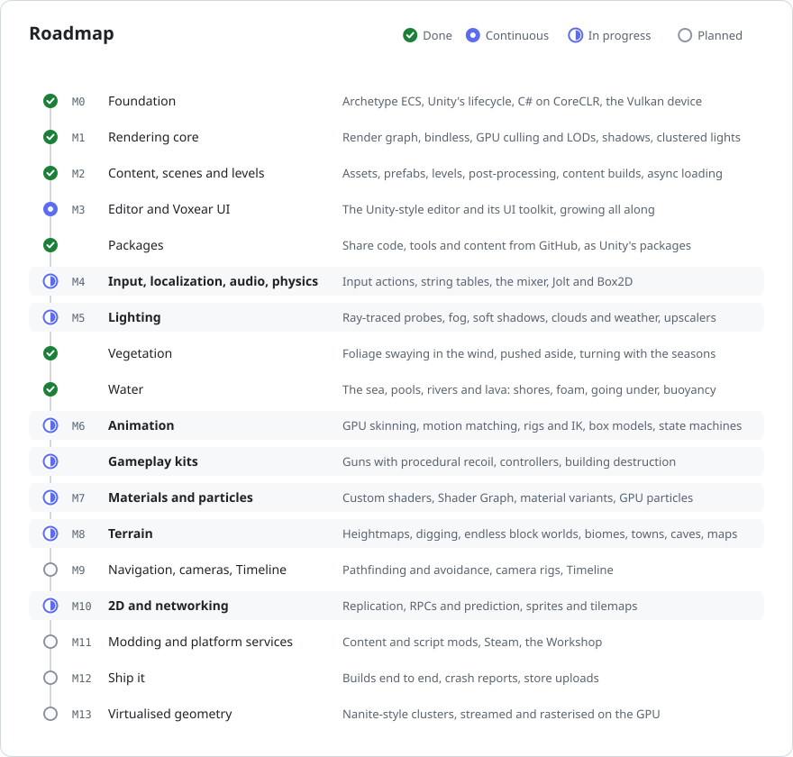

# Voxear

A game engine for people who like how Unity works, and want an engine that is fast, open and theirs to change. It
has a Rust core, a Vulkan renderer, C# scripting on .NET, and an editor laid out the way Unity users expect.

## What Voxear is for

- **Making games the way you already know.** Objs with components, scenes, prefabs, an Inspector, a Scene view with
  Unity's controls, and C# behaviours with `Awake`, `Start` and `Update`. What you know from Unity carries over.
- **Speed without fuss.** A data-oriented core and a GPU-driven renderer that culls, picks levels of detail and
  lights thousands of objects by itself, with a profiler and a frame debugger built in to show where time goes.
- **Easy first, open all the way down.** Every system has a simple way in and a full API underneath, and nothing is
  a black box. A game's own scripts can add windows, side bar buttons, commands and Inspector drawers to the editor,
  and packages will let people share them.
- **Game-ready kits,** coming: a gun kit with procedural recoil, first-person, third-person, top-down and vehicle
  controllers, and destruction for buildings, each a component to add and play, and open to change.
- **Linux and Windows,** built and used on Linux from the first day.

<picture>
  <source media="(prefers-color-scheme: dark)" srcset="docs/images/roadmap-dark.svg">
  
</picture>

- [Roadmap](docs/ROADMAP.md): each milestone in full, and open questions.
- [Architecture](docs/ARCHITECTURE.md): what the engine is and how each system works.
- [The Voxear Manual](manual/_folder.md): how to make games with Voxear, as the editor's VoxDocs shows it.

## Requirements

- Rust (stable, 1.88 or newer)
- .NET 10 SDK: `sudo pacman -S dotnet-sdk` on Arch, `winget install Microsoft.DotNet.SDK.10` on Windows
- A GPU with Vulkan 1.3
- Slang (`slangc`): `sudo pacman -S shader-slang` on Arch, or the Vulkan SDK on Windows
- Optional: RenderDoc (`sudo pacman -S renderdoc`) for frame captures

## Quick start

```bash
cargo build
```

```bash
./target/debug/vox doctor
```

```bash
./target/debug/vox run samples/Hello
```

`vox run` builds the project's C# scripts, hosts .NET, loads the project's `start_level` and opens a window. A
level is a list of scenes (`Levels/*.level`, `Scenes/*.scene`, both plain TOML). In Hello, the Game Manager switches
between a day and a night level every five seconds, and their shared environment scene stays loaded.
`vox new ~/Games/Orbit` makes a new project (`--template empty` for a bare one, `--git` for a repository).
`vox assets samples/Hello` lists a project's assets and their GUIDs. Add
`--headless --frames 120` to simulate without a window and print where every Obj ended up.

In the window:
- **Fly around:** hold the right mouse button. WASD moves, Q/E go down and up, Shift goes faster, and the mouse wheel
  changes speed. These are Unity's scene-view controls.
- **Debug views:** F2 shows LODs, F3 shadow cascades, F4 lights per cluster, and F5 normals.
- **Frame capture:** F12 captures a frame in RenderDoc when run with `--renderdoc`.
- **Shader hot reload:** shaders in `crates/voxear_render/shaders` reload on save.
- **Script hot reload:** the project's C# scripts build and reload into the running game when one changes, keeping
  what its behaviours hold.

```bash
./target/debug/vox render samples/Hello --out frame.png
```

`vox render` draws the project offscreen to a PNG and prints:
- GPU time per render pass
- culling counts: what was outside the view, what was hidden by occlusion, and what was drawn
- how many draws used each LOD
- the exposure auto exposure settled on

Options:
- `--debug-view lod` colours objects by their LOD, and `--debug-view cascades` by shadow cascade. F2 and F3 do the
  same in the window.
- `--post neutral` or `--post cinematic` swaps the scene's post-processing for another preset, to compare with the
  default Voxear Look.
- `--renderdoc` also saves a RenderDoc capture to the project's `.voxear/Captures`.

Post-processing is on by default: TAA, bloom, auto exposure, AgX tonemapping, a soft vignette and height fog. A
scene changes it in a `[post]` section; `samples/Lights` has an example, and
[Post-processing](docs/ARCHITECTURE.md#post-processing-and-the-voxear-look) lists every setting.

`vox content build samples/Hello` packs the content into bundles, grouped by which levels and prefabs use each asset.
`vox run samples/Hello --bundles` then plays from those bundles as a built game would, logging each one as it opens.

More samples:
- `samples/Stress` has 1,600 spheres and a wall, for trying culling and LODs.
- `samples/Lights` has 256 coloured point lights at night, for clustered lighting.

`--debug-view` takes `lod`, `cascades`, `lights` or `normals`.

Tests: `cargo test` for the engine, and `dotnet run --project managed/Voxear.Core.Tests` for the C# helpers that
run without the engine.

Set `VOXEAR_LOG=debug` for more logging. Set `VOXEAR_VALIDATION=1` to force Vulkan validation; debug builds use it
automatically when the `vulkan-validation-layers` package is installed.

## Releases

The [Voxear Launcher](https://github.com/CookieJarTools/VoxearLauncher) installs engine releases from
[VoxearReleases](https://github.com/CookieJarTools/VoxearReleases). To package this checkout as one:

```bash
cargo run -p voxear_dist -- --channel nightly
```

That writes an install folder and its `.tar.zst` to `target/dist`. The launcher's `voxear-release engine add` then
signs the archive and lists it; "Versions, installs and the launcher" in the architecture has the rest.

## Layout

```
crates/     Rust engine, one crate per system (ecs, scene, rhi, render, scripting, engine, cli)
managed/    C# scripting API (Voxear.Core)
samples/    example projects
docs/       architecture and roadmap
manual/     the Voxear Manual, which every install ships and VoxDocs shows
```

## Licence

Voxear is licensed under the [PolyForm Shield License 1.0.0](LICENSE.md): you may use, change and ship games
with it, but not use it to build a product that competes with Voxear itself.

Required Notice: Copyright 2026 Joseph Cook
