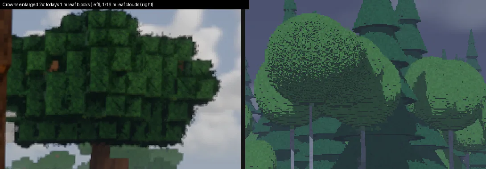
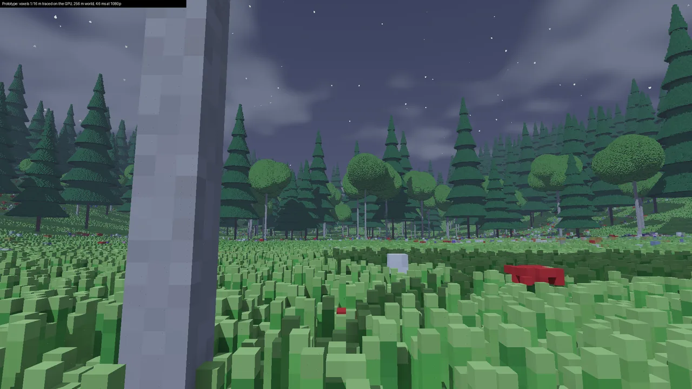

# Small voxels: worlds built of voxels a few centimetres across

Research into making worlds whose voxels are a few centimetres across, rather than worlds of one-metre blocks with
some small-cube decoration. The look wanted is:

- grass blades and flowers made of cubes a few centimetres across;
- round-crowned trees and tall conifers whose leaves are clouds of small cubes;
- hillsides of small cubes in the distance;
- a whole town and forest built that way out to the horizon, that players can break, place and move a voxel at a
  time.

Written 2026-11-24, measured on the RTX 3070 at 1920×1080. The prototype is
[`crates/voxear_rhi/examples/small_voxels.rs`](../../crates/voxear_rhi/examples/small_voxels.rs) and its shader
`small_voxels.slang` beside it.

## The short version

- **Yes, Voxear can make this look, but not by making blocks smaller.**
  - Every block world today is drawn as meshes of quads, and quads are what break.
  - The 256 m scene below, meshed at 1/16 m, has 455 million faces showing: 372 million quads even after joining
    runs of one colour, about 3 GB. Voxear's blocks already struggle at 0.4 m.
- **What works is tracing the voxels on the GPU.** A compute shader walks each pixel's ray through a sparse grid
  of bricks, and the world keeps no meshes at all. The prototype draws a 256 m meadow and forest of 1/16 m voxels:
  - 3.0 ms at 1080p for the picture itself;
  - 4.6 ms with traced shadows and ambient occlusion;
  - 343 MB on the GPU, made in 3.8 s on 24 cores.

  The frame time hardly depends on the world's size. The memory grows with its area and with the square of the
  voxels to a metre.
- **The recommended shape keeps the block world.**
  - The one-metre grid stays the world's layout, as it is now. Generator graphs, region files, `Blocks` in C#,
    physics, navigation and the network all keep working on it.
  - Each kind of block is drawn as a pattern of 16×16×16 small voxels, shared by every block of that kind.
  - Only what is unique (plants, trees, carved spots, small-voxel buildings) is kept as bricks of its own.

  Ground and grass at 1/16 m measured 110 MB for 256 m square as unique bricks. As patterns they cost about what
  blocks cost now.
- **Distance is handled in rings.** Voxels are 1/16 m near the camera, then 1/8 and 1/4 m further out, then
  one-metre blocks, then the far view that is already baked.
- **The plan has seven stages.** Stage 1 alone gives small-voxel models and props in any scene. Stages 1 and 2
  give the meadow picture. Stages 1 to 5 give the town to the horizon, editable a voxel at a time.

## What the references show

- **The night meadow.**
  - Grass blades one voxel across and a few to a dozen tall, at about 1/16 m.
  - Red, purple and white flower heads of 3–5 voxels.
  - Thin pale trunks with round crowns.
  - Tall conifers, every leaf a small cube.
  - A hillside of small cubes behind.
- **The town and forest.**
  - Tiled roofs, stairs, bridges and windows, all of small voxels.
  - Broad trees whose crowns are clouds of cubes.
  - Hills of small voxels to a horizon a kilometre or more off.
  - Break, place, move and copy tools that work on single voxels and on whole objects. Its overlay shows 3.4 ms a
    frame, on hardware not stated.

## What Voxear has today

| Piece | Size of its cubes | Where it stops |
|---|---|---|
| Block Worlds | 1 m by default; 0.1 m to 10 m allowed | Drawn as meshed quads. At 0.4 m a Generated Block World is 758k triangles and 831 ms to load; Voxel Terrain at 0.4 m is 1.26M triangles; the endless world never settled. |
| Relief look (`BlockVoxels`, `blockCubes`) | up to 64 a block side, 4 deep | Shading only: the ray is walked across small cubes inside a face, but silhouettes stay the block's, and no depth is written. |
| Ground cover (`[[ground_cover]]`) | plants of 1/8 m cubes | Scattered on the GPU round the camera to 60–90 m, swaying: 1.7 ms for 3 tufts a block to 60 m. Decoration, not world. |
| Plants of cubes (box models) | 1/8 m, 1/16 for the smallest | About 0.2–0.3 ms per 1,000 on screen, with blocky LODs. |
| Sculpted box models | up to 256 a side, in 16³ chunks | Meshed like blocks. Props and characters, not ground. |
| Trees (`.voxplant`) | 1 m log and leaf blocks | Crowns are blocks of leaves with a picture. |

Below is CubeGame's Realm today, at the player's start, after 600 frames. Its GPU frame took 5.4 ms, the least of
the last 28. Of that, the blocks' depth, opaque and shadow passes took 1.8 ms, and the ground cover about 0.8 ms.

Where it falls short of the references, looked at close up:

- **The ground steps a metre at a time.** The edge of the meadow is a one-metre ledge of dirt, and the far shore
  and hills are one-metre steps.
- **Crowns are one-metre leaf blocks with a picture on each face**, not clouds of cubes. Enlarged twice below,
  against the prototype's crowns of 1/16 m voxels:

  
- **The grass and flowers are close to the reference already**, but they are decoration. They end at their draw
  distance, and nothing under them is small.
- **Nothing smaller than a block can be dug or built.**

Why: every piece of a block world becomes faces of quads on the CPU and is drawn as triangles. That is why 0.4 m
blocks were already slow. At 1/16 m the faces are what break, as the next section measures.

## The options

### A. Smaller blocks everywhere, meshed as now

The prototype's world was counted as it would be meshed:

| World | Faces that show | Quads, runs of one colour joined | Quads at 8 bytes |
|---|---|---|---|
| 256 m at 1/16 m | 455M | 372M | 2,977 MB |
| 256 m at 1/8 m | 95M | 79M | 630 MB |
| 1,024 m at 1/8 m | 1,693M | 1,403M | 11,227 MB |

A grass blade or a leaf voxel stands alone, so joining saves only a fifth. Today's endless block world has 152k
triangles in view. **Not possible.**

### B. Meshes near, something else further out

Within 32 m of the camera at 1/16 m that is still about 18M quads (36M triangles), on the measured 5,700 quads a
square metre. That is tens of milliseconds of triangles, and the far tiers would need tracing anyway. **No.**

### C. Tracing the voxels on the GPU

One compute thread a pixel walks its ray through the grid. The prototype measured this, below. Data structures
weighed:

| Structure | For | Against |
|---|---|---|
| Dense grid | Simplest walk | 4,096 voxels to a cubic metre: impossible past a room |
| Two levels: a grid of bricks | Simple, fast to edit and stream | Big empty spaces still cost a step a brick |
| **Three levels: sectors of 8³ bricks of 8³ voxels (the prototype)** | Steps over a 4 m sector, a 0.5 m brick or one voxel; LODs come free from the masks; a brick is edited and uploaded alone | Rays skimming grass take hundreds of steps |
| Sparse octree | Adapts to anything | Twice the levels, slower walk, harder to edit |
| Shared-node graph (one copy of each repeated subtree) | Very small for repeating worlds | Edits rebuild shared nodes; poor for a world that changes |
| Hardware ray tracing with a box per brick | Uses the RT cores | Intersection shaders are slow; GPUs without ray tracing (which Voxear supports) need the compute walk anyway |

**Chosen: the three levels, walked in compute,** with one more level above the sectors for long rays through
empty sky.

### D. Blocks that hold patterns of small voxels

The one-metre block world stays as it is: its chunks, palettes, edits and region files. Each kind of block gets a
pattern of 16³ voxels, for example:

- a grass block is dirt with blades on top;
- a leaf block is a cloud of leaves that thins towards the air beside it;
- stone has cracks.

The tracer walks chunk, then block, then the block's pattern. A world drawn smooth already keeps how full each
block is (`Fill`), and that cuts the pattern into a slope, so hills step 6 cm at a time instead of a metre. A
hash of the place picks a variant and turning of the pattern, so the repeats don't show.

- **Memory:** a block world costs what it does now, plus one pattern per kind of block (4 KB each).
- **Where it falls short:** shapes finer than a block need bricks of their own. That covers a tree's crown, a
  flower or a dug hole. Option C keeps those.

**Chosen: D on top of C.** That is how the town, the meadow and a world of blocks can all be small voxels without a
gigabyte of bricks.

## The prototype

`cargo run --release -p voxear_rhi --example small_voxels -- 256 16 out`

That makes a world 256 m across at 16 voxels a metre and writes the pictures to `out`.

- **The scene.** A meadow of one-voxel grass blades and flowers before a forest of round-crowned trees and
  conifers, with hills behind and to the sides.
- **Generation.** It is made on the CPU on every core and uploaded once.
- **The trace.** One compute pass at 1920×1080 walks the rays and casts a second ray for moonlight shadows.
  Ambient occlusion comes from the voxels round each face's corners.
- **Storage.**
  - A sector: 512 bits for its bricks, their counts, and where its bricks start (100 bytes).
  - A brick: 512 bits for its voxels, 64 bits for its 2×2×2 groups, and its average colour (80 bytes).
  - Materials: one byte per solid voxel.
  - The inside of a hill is left out. The ground is filled down only to its lowest neighbour, so no ray can get
    under it. A crown is a shell of leaves 9 voxels deep.
- **Levels of detail.**
  - Where a voxel is under half a pixel, the walk stops at the 2×2×2 groups.
  - Under an eighth of a pixel, it stops at whole bricks in their average colour.
  - A ray that has taken many steps goes coarser the same way, so a ray skimming the grass never runs out of steps.

The colours and night light are rough: lighting is not what was measured. In Voxear the voxels would take the
engine's own sun, sky, fog, GI and post-processing, as any surface does.

### Measured

Each time is the least of 60 frames after 20 to warm up. "Meadow" is the picture above. "Over" looks down from
30 m. The GPU was shared with other sessions, which used about a fifth of it at the start.

| World | Voxels | Bricks | Solid voxels | GPU memory | Made in (24 threads) | Made a ms | Upload | Meadow | Meadow, picture only | Meadow, no LOD | Over | Over, no LOD |
|---|---|---|---|---|---|---|---|---|---|---|---|---|
| 256 m | 1/16 m | 1.69M | 198M | 343 MB | 3.8 s | 17 m² | 82 ms | 4.55 ms | 3.02 ms | 5.15 ms | 4.39 ms | 5.90 ms |
| 256 m, ground and grass only | 1/16 m | 0.53M | 58M | 110 MB | 0.85 s | 77 m² | – | 3.52 ms | 2.80 ms | – | – | – |
| 512 m | 1/16 m | 7.18M | 833M | 1,447 MB | 18.5 s | 14 m² | 953 ms | 5.87 ms | 3.83 ms | 6.44 ms | 5.12 ms | 6.92 ms |
| 128 m | 1/32 m | 1.76M | 224M | 384 MB | 5.4 s | 3 m² | 275 ms | 4.69 ms | 3.65 ms | 5.43 ms | 3.81 ms | 5.42 ms |
| 256 m | 1/8 m | 0.37M | 43M | 73 MB | 0.70 s | 94 m² | 22 ms | 3.65 ms | 2.19 ms | 3.86 ms | 4.02 ms | 4.73 ms |
| 1,024 m | 1/8 m | 6.42M | 748M | 1,281 MB | 14.5 s | 72 m² | 1,154 ms | 4.07 ms | 2.75 ms | 4.37 ms | 4.84 ms | 5.80 ms |

What the numbers say:

- **The picture costs about 3 ms at 1080p.** Traced shadows and occlusion add about 1.5 ms. At the 67% render scale
  TAA upscales from, it would be about 2 ms and 3 ms.
- **Memory is about 1.7 bytes a solid voxel.** That is 1.3 KB a square metre for meadow and forest at 1/16 m, and
  each halving of the voxel costs 4.7 times the memory.
  - Trees and flowers are two thirds of it: 233 of 343 MB.
  - Materials are 58%. A palette of 1 to 4 bits a voxel in each brick would bring 343 MB to about 180 MB.
- **The levels of detail save 0.6–1.5 ms.** Their real use is keeping far crowns from shimmering. Without them, a
  hashed crown shows rings of moiré.
- **The world's size barely moves the frame.** 256 m to 512 m at 1/16 m added 1.3 ms, because more far hill shows.
- **Rays skimming the grass are the cost.** The picture below counts each pixel's steps: the meadow's far edge and
  the trees' outlines take hundreds.

  
- **Making the world: 17 m² a ms at 1/16 m on 24 cores**, with a simple generator.
  - Walking at 5 m/s with 256 m in view brings 1,280 m² a second into view: 75 ms of all 24 cores.
  - Running at 10 m/s doubles that.
  - Flying at 40 m/s needs the coarser rings, which are made 4 to 20 times faster.
  - Upload ran at about 4 GB/s.
- **1/8 m against 1/16 m:** a fifth of the memory and two thirds of the time, but blades and flowers turn to
  blocks. The reference is nearer 1/16.

  

### Not measured

- Composing with the rest of the frame (depth, TAA, water, meshes), and the GI.
- A view with many unique buildings, as in the town picture.
- Instanced models in the bricks.
- Streaming while moving.

## How it fits what exists

- **The renderer.**
  - **The voxel pass.** A voxel pass in the render graph writes the frame's depth and the same surface data the
    meshes write, so lights, fog, TAA, water, glass, particles and post all work over it. Meshes such as
    characters and props draw against its depth as now.
  - **Sun shadows.** Voxels get traced shadows, as in the prototype. Lighting a mesh pixel also traces the sun ray
    through the voxels, and lighting a voxel samples the shadow maps for meshes.
  - **GI.** It already has a software path (`trace_software.slang`). Its rays walk the bricks instead of triangles.
- **Block Worlds.** The chunk grid, palettes and `Fill` stay.
  - Block definitions gain a **Voxels** look: a pattern from a box model, sculpted in the box model editor, which
    already makes 16³ chunks. It has variants, and a choice to thin towards air for leaves.
  - Ground cover rows become voxel stamps.
  - The relief look (`blockCubes`) is the same idea, done in shading only. Patterns replace it near and keep it as
    the cheap far tier.
- **Generator graphs.** They make blocks as now. The patterns give the detail. Nodes for small-voxel stamps
  (rocks, flowers, crowns) place unique bricks as `FarTile::add` places structures.
- **Streamed worlds and the far view.**
  - Near the camera, rings of unique bricks: 1/16 m to about 128 m, then 1/8 m to about 256 m, then 1/4 m to
    1 km.
  - Past that, the baked far view (`FarTile` runs at one metre per column, coarsest first) as now. At 1 km a
    one-metre block is about a pixel.
  - The patterns cost nothing to stream: blocks stream as they do now.
  - Estimated worst case with every ring unique and no palettes: about 760 MB. With patterns for the ground and
    palettes, a few hundred.
- **Region files and saves.** Block edits are kept as now (`.blocks` version 5, runs and zstd). A voxel edit is
  kept as the brick that differs from what the pattern or the generator made: its mask and materials, zstd'd.
  Only bricks someone changed are written.
- **Network edits.** Edits go out as commands that every machine plays the same way: carve a ball, set a voxel,
  stamp a model, each with its block kind. A joining player gets the changed bricks in compacted form, as block
  changes are sent now.
- **Physics.**
  - Solid blocks collide as now. A block's pattern gives its shape: the whole cube, or boxes from the pattern's
    4³ groups.
  - Grass, flowers and leaves have a material that doesn't collide.
  - Unique bricks near a body are meshed into collision at 1/8 m, or given a collision shape that reads the brick
    masks.
- **Navigation.** Agents walk blocks as now. Where voxels were edited, the brick masks give a walkable grid at
  1/2 m.
- **Block light.** Each block's two lights are sampled smoothly at the voxel's place, so torches and sky light
  reach in under overhangs and into caves at voxel scale with nothing kept per voxel.
- **C#.**
  - `Blocks` keeps working.
  - A new `Voxels` class adds `Carve(middle, radius)`, `Set(position, block)`, `Stamp(model, at, turn)` and
    `Raycast`, the last returning a voxel hit with its block.
  - Patterns and models are typed asset references with pickers, never names in strings.
  - Everything is reachable from `vox editor call` and `vox mcp`.
- **Swaying plants.** Traced voxels do not move with a vertex shader.
  - Near the camera, swaying grass and flowers stay today's ground cover meshes, which sway, push aside and
    spring back. Past them, the voxels stand still.
  - Bending the ray by the wind inside plant bricks is a research item. It may tear at the edges.

## The plan

Costs are GPU time at 1080p on the RTX 3070, memory on the GPU, and the work as a guess in sessions like this
one.

| Stage | What it gives | GPU | Memory | Work |
|---|---|---|---|---|
| 1. **Voxel pass and Voxel Volumes** | A sparse brick volume as an Obj, traced into the frame's depth and surfaces with traced sun shadows; box models stamped into it; seen in the editor and in renders | ~2 ms at 67% scale, +1 ms shadows | 1.3 KB/m² of detail | 3–4 |
| 2. **Blocks drawn as patterns** | A Block World drawn by the tracer with 16³ patterns per block kind, slopes cut by `Fill`, leaves thinning at the edges; ground and hills of small voxels | about stage 1's | patterns, 4 KB a kind | 3 |
| 3. **Plants and trees of small voxels** | Ground cover, grown plants and `.voxplant` crowns as voxel stamps; then models shared between bricks so a forest costs one tree per kind | +0.5 ms | 230 MB a 256 m forest unshared; tens of MB shared | 3 |
| 4. **Editing a voxel at a time** | `Voxels` in C#, an editor brush, changed bricks in region files, edit commands over the network, picking | – | changed bricks only | 2–3 |
| 5. **Distance in rings** | 1/16, 1/8, 1/4 m rings and blocks beyond, streamed within the world budget, then the baked far view | +0.5 ms | 400–760 MB | 3 |
| 6. **Lighting at voxel scale** | GI rays in voxels, occlusion and glowing voxels, block light sampled smoothly | 1–2 ms | – | 2 |
| 7. **Physics, navigation and debris at voxel scale** | Collision from patterns and bricks, broken pieces as falling voxel objects, voxel characters | – | – | 3–4 |

- **Stages 1 and 2 give the night meadow.** Ground, grass and hills come from patterns, and flowers and crowns
  from stamps.
- **Stages 1 to 5 give the town to the horizon,** editable a voxel at a time. Stages 6 and 7 bring the lighting and
  physics up to the same scale.
- **Stage 1 stands alone.** Voxel props, ruins and statues in any scene, today's block worlds included, are worth
  having without the rest.
- **Risks.**
  - Fitting the traced depth and surfaces into TAA and the existing passes without seams where meshes meet
    voxels.
  - Shimmer in far crowns, which needs the levels of detail plus TAA.
  - The cost of rays that skim the grass.

## Kept elsewhere

- The prototype's output as printed, the reference pictures and the prototype beside the meadow reference are in
  the shared notes of the sessions that did this research (`small-voxels.md` and its folder).
