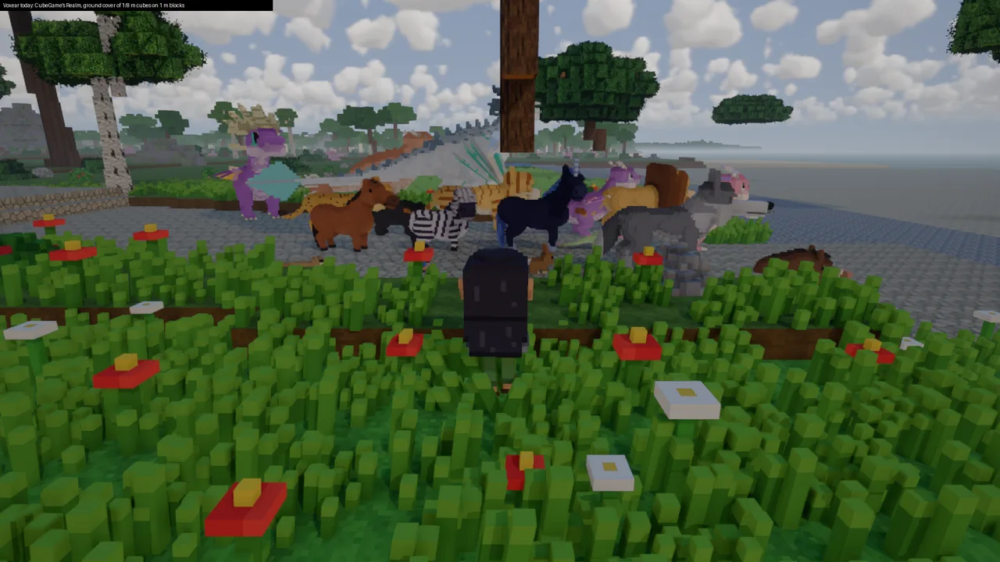
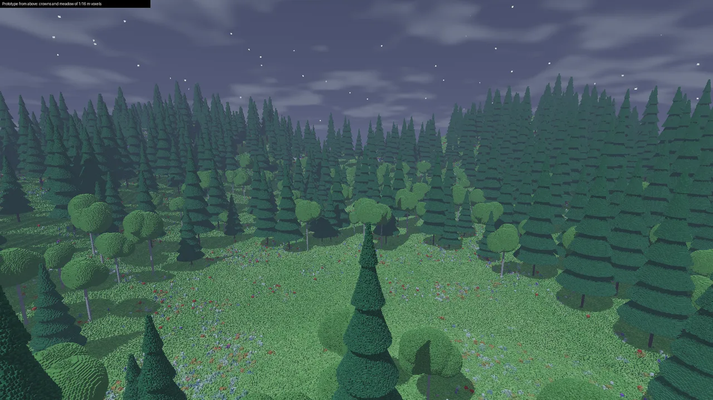
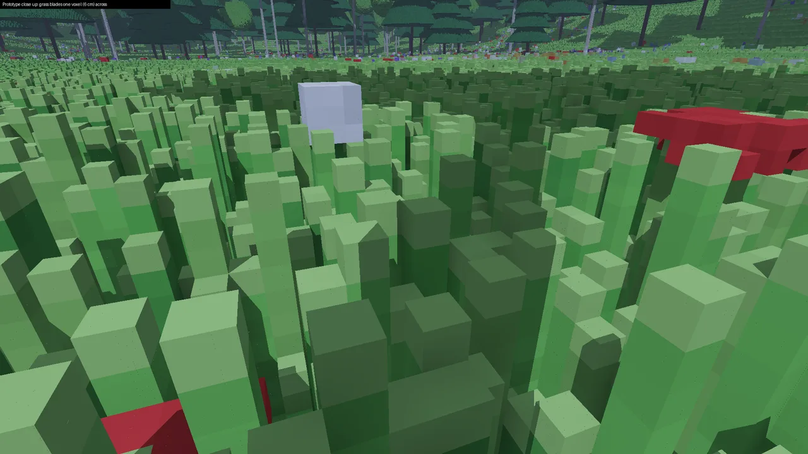
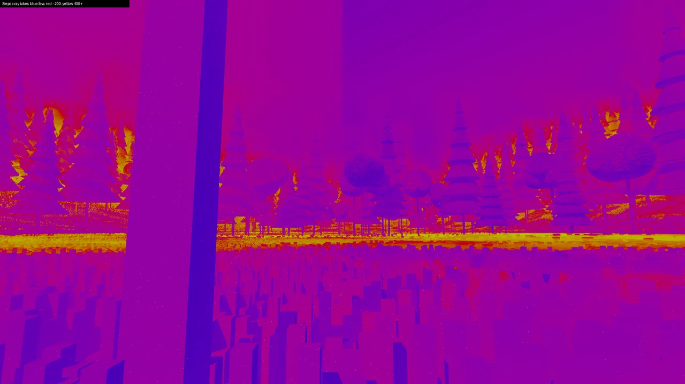
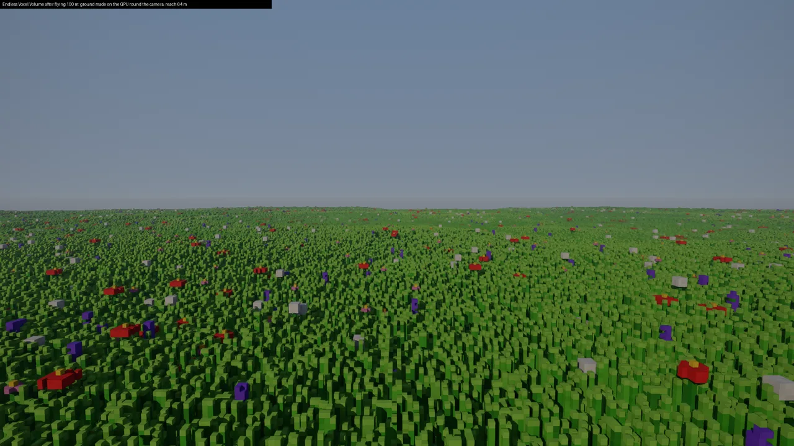
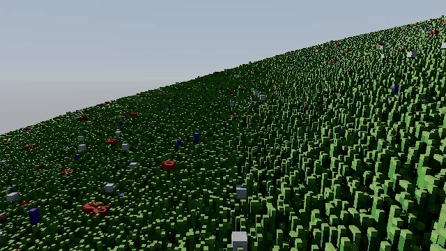
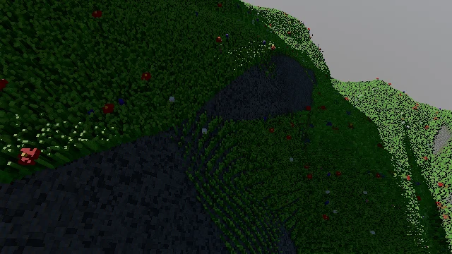
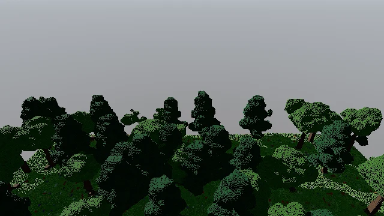
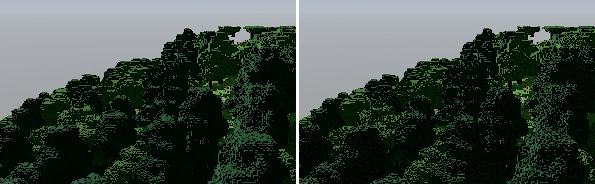
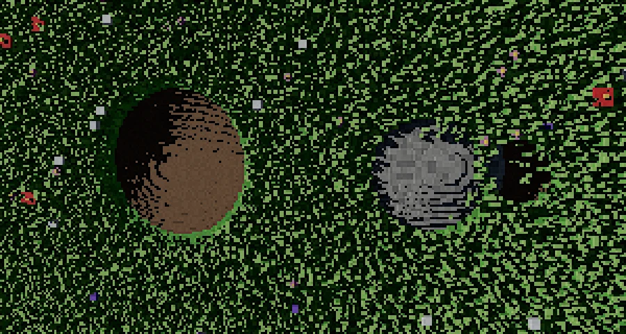

# Small voxels: worlds built of voxels a few centimetres across

Research into making worlds whose voxels are a few centimetres across, rather than worlds of one-metre blocks with
some small-cube decoration. The look wanted is:

- grass blades and flowers made of cubes a few centimetres across;
- round-crowned trees and tall conifers whose leaves are clouds of small cubes;
- hillsides of small cubes in the distance;
- a whole town and forest built that way out to the horizon, that players can break, place and move a voxel at a
  time.

Written 2026-11-24, measured on the RTX 3070 at 1920×1080. The prototype is
[`crates/voxear_rhi/examples/small_voxels/`](../../crates/voxear_rhi/examples/small_voxels/main.rs). It holds
the world made on the CPU (`main.rs`) and on the GPU (`gpu_make.rs`, `make.slang`), and three ways of drawing
it: the walk and the coarse first pass (`trace.slang`), and bricks drawn as boxes (`raster.slang`).

## The short version

- **Yes, Voxear can make this look, but not by making blocks smaller.**
  - Every block world today is drawn as meshes of quads, and quads are what break.
  - The 256 m scene below, meshed at 1/16 m, has 455 million faces showing: 372 million quads even after joining
    runs of one colour, about 3 GB. Voxear's blocks already struggle at 0.4 m.
- **Tracing the voxels on the GPU works.** A compute shader walks each pixel's ray through a sparse grid of
  bricks, and the world keeps no meshes at all. The prototype draws a 256 m meadow and forest of 1/16 m voxels:
  - 3.0 ms at 1080p for the picture itself;
  - 4.6 ms with traced shadows and ambient occlusion;
  - 343 MB on the GPU.

  The frame time hardly depends on the world's size. The memory grows with its area and with the square of the
  voxels to a metre.
- **The fastest ways found, measured against each other on the same worlds:**
  - **Making the world on the GPU** is 11 to 16 times faster than on all 24 CPU cores. The 256 m world took 225 ms
    against 3.6 s, and both made the same world.
  - **Drawing:** a coarse pass first, one ray every 4×4 pixels against whole bricks, lets every ray start near what
    it will hit. It took 5–45% off the picture.
  - Drawing each brick as a box with triangles and walking only inside it was no faster here.
- **No blocks are needed.** The world is small voxels throughout, with no one-metre grid under it. Memory is kept
  down by:
  - a palette in each brick;
  - sharing bricks that repeat, such as many trees of one kind;
  - making the world again on the GPU as it comes into view, and keeping only what players changed.

  Drawing block worlds as patterns of small voxels stays an option, for the worlds of blocks that exist.
- **Distance is handled in rings.** Voxels are 1/16 m near the camera, then 1/8 and 1/4 m further out, then
  coarser still to the horizon.
- **The plan has seven stages.** Stage 1 alone gives small-voxel models and props in any scene. Stages 1 and 2
  give the meadow picture. Stages 1 to 5 give the town to the horizon, editable a voxel at a time.

## What the references show

- **The night meadow.**
  - Grass blades one voxel across and a few to a dozen tall, at about 1/16 m.
  - Red, purple and white flower heads of 3–5 voxels.
  - Thin pale trunks with round crowns.
  - Tall conifers, every leaf a small cube.
  - A hillside of small cubes behind.
- **The town and forest.**
  - Tiled roofs, stairs, bridges and windows, all of small voxels.
  - Broad trees whose crowns are clouds of cubes.
  - Hills of small voxels to a horizon a kilometre or more off.
  - Break, place, move and copy tools that work on single voxels and on whole objects. Its overlay shows 3.4 ms a
    frame, on hardware not stated.

## What Voxear has today

| Piece | Size of its cubes | Where it stops |
|---|---|---|
| Block Worlds | 1 m by default; 0.1 m to 10 m allowed | Drawn as meshed quads. At 0.4 m a Generated Block World is 758k triangles and 831 ms to load; Voxel Terrain at 0.4 m is 1.26M triangles; the endless world never settled. |
| Relief look (`BlockVoxels`, `blockCubes`) | up to 64 a block side, 4 deep | Shading only: the ray is walked across small cubes inside a face, but silhouettes stay the block's, and no depth is written. |
| Ground cover (`[[ground_cover]]`) | plants of 1/8 m cubes | Scattered on the GPU round the camera to 60–90 m, swaying: 1.7 ms for 3 tufts a block to 60 m. Decoration, not world. |
| Plants of cubes (box models) | 1/8 m, 1/16 for the smallest | About 0.2–0.3 ms per 1,000 on screen, with blocky LODs. |
| Sculpted box models | up to 256 a side, in 16³ chunks | Meshed like blocks. Props and characters, not ground. |
| Trees (`.voxplant`) | 1 m log and leaf blocks | Crowns are blocks of leaves with a picture. |

Below is CubeGame's Realm today, at the player's start, after 600 frames. Its GPU frame took 5.4 ms, the least of
the last 28. Of that, the blocks' depth, opaque and shadow passes took 1.8 ms, and the ground cover about 0.8 ms.

Where it falls short of the references, looked at close up:

- **The ground steps a metre at a time.** The edge of the meadow is a one-metre ledge of dirt, and the far shore
  and hills are one-metre steps.
- **Crowns are one-metre leaf blocks with a picture on each face**, not clouds of cubes. Enlarged twice below,
  against the prototype's crowns of 1/16 m voxels:

  
- **The grass and flowers are close to the reference already**, but they are decoration. They end at their draw
  distance, and nothing under them is small.
- **Nothing smaller than a block can be dug or built.**

Why: every piece of a block world becomes faces of quads on the CPU and is drawn as triangles. That is why 0.4 m
blocks were already slow. At 1/16 m the faces are what break, as the next section measures.

## The options

### A. Smaller blocks everywhere, meshed as now

The prototype's world was counted as it would be meshed:

| World | Faces that show | Quads, runs of one colour joined | Quads at 8 bytes |
|---|---|---|---|
| 256 m at 1/16 m | 455M | 372M | 2,977 MB |
| 256 m at 1/8 m | 95M | 79M | 630 MB |
| 1,024 m at 1/8 m | 1,693M | 1,403M | 11,227 MB |

A grass blade or a leaf voxel stands alone, so joining saves only a fifth. Today's endless block world has 152k
triangles in view. **Not possible.**

### B. Meshes near, something else further out

Within 32 m of the camera at 1/16 m that is still about 18M quads (36M triangles), on the measured 5,700 quads a
square metre. That is tens of milliseconds of triangles, and the far tiers would need tracing anyway. **No.**

### C. Tracing the voxels on the GPU

One compute thread a pixel walks its ray through the grid. The prototype measured this, below. Data structures
weighed:

| Structure | For | Against |
|---|---|---|
| Dense grid | Simplest walk | 4,096 voxels to a cubic metre: impossible past a room |
| Two levels: a grid of bricks | Simple, fast to edit and stream | Big empty spaces still cost a step a brick |
| **Three levels: sectors of 8³ bricks of 8³ voxels (the prototype)** | Steps over a 4 m sector, a 0.5 m brick or one voxel; LODs come free from the masks; a brick is edited and uploaded alone | Rays skimming grass take hundreds of steps |
| Sparse octree | Adapts to anything | Twice the levels, slower walk, harder to edit |
| Shared-node graph (one copy of each repeated subtree) | Very small for repeating worlds | Edits rebuild shared nodes; poor for a world that changes |
| Hardware ray tracing with a box per brick | Uses the RT cores | Intersection shaders are slow; GPUs without ray tracing (which Voxear supports) need the compute walk anyway |

**Chosen: the three levels, walked in compute,** with one more level above the sectors for long rays through
empty sky.

### D. Blocks that hold patterns of small voxels (an option for block worlds)

This is for worlds of blocks that already exist, not for a world of small voxels. The one-metre block world stays
as it is: its chunks, palettes, edits and region files. Each kind of block gets a pattern of 16³ voxels, for
example:

- a grass block is dirt with blades on top;
- a leaf block is a cloud of leaves that thins towards the air beside it;
- stone has cracks.

The tracer walks chunk, then block, then the block's pattern. A world drawn smooth already keeps how full each
block is (`Fill`), and that cuts the pattern into a slope, so hills step 6 cm at a time instead of a metre. A
hash of the place picks a variant and turning of the pattern, so the repeats don't show.

- **Memory:** a block world costs what it does now, plus one pattern per kind of block (4 KB each).
- **Where it falls short:** shapes finer than a block need bricks of their own. That covers a tree's crown, a
  flower or a dug hole. Option C keeps those.

**Chosen: C, a world of small voxels throughout.** D is a later option for today's block worlds.

## The prototype

`cargo run --release -p voxear_rhi --example small_voxels -- 256 16 out`

That makes a world 256 m across at 16 voxels a metre and writes the pictures to `out`. Each view is drawn by every
method in turn. `SMALL_VOXELS_FACES=1` also counts the faces meshing would need, and `SMALL_VOXELS_GROUND_ONLY=1`
leaves out the trees and flowers.

- **The scene.** A meadow of one-voxel grass blades and flowers before a forest of round-crowned trees and
  conifers, with hills behind and to the sides.
- **Generation.** It is made on the CPU on every core and uploaded once, then made again on the GPU and checked
  against the CPU's.
- **The trace.** One compute pass at 1920×1080 walks the rays and casts a second ray for moonlight shadows.
  Ambient occlusion comes from the voxels round each face's corners.
- **Storage.**
  - A sector: 512 bits for its bricks, their counts, and where its bricks start (100 bytes).
  - A brick: 512 bits for its voxels, 64 bits for its 2×2×2 groups, and its average colour (80 bytes).
  - Materials: one byte per solid voxel.
  - The inside of a hill is left out. The ground is filled down only to its lowest neighbour, so no ray can get
    under it. A crown is a shell of leaves 9 voxels deep.
- **Levels of detail.**
  - Where a voxel is under half a pixel, the walk stops at the 2×2×2 groups.
  - Under an eighth of a pixel, it stops at whole bricks in their average colour.
  - A ray that has taken many steps goes coarser the same way, so a ray skimming the grass never runs out of steps.

The colours and night light are rough: lighting is not what was measured. In Voxear the voxels would take the
engine's own sun, sky, fog, GI and post-processing, as any surface does.

### Measured

Each time is the least of 60 frames after 20 to warm up. "Meadow" is the picture above. "Over" looks down from
30 m. The GPU was shared with other sessions, which used about a fifth of it at the start.

| World | Voxels | Bricks | Solid voxels | GPU memory | Made in (24 threads) | Made a ms | Upload | Meadow | Meadow, picture only | Meadow, no LOD | Over | Over, no LOD |
|---|---|---|---|---|---|---|---|---|---|---|---|---|
| 256 m | 1/16 m | 1.69M | 198M | 343 MB | 3.8 s | 17 m² | 82 ms | 4.55 ms | 3.02 ms | 5.15 ms | 4.39 ms | 5.90 ms |
| 256 m, ground and grass only | 1/16 m | 0.53M | 58M | 110 MB | 0.85 s | 77 m² | – | 3.52 ms | 2.80 ms | – | – | – |
| 512 m | 1/16 m | 7.18M | 833M | 1,447 MB | 18.5 s | 14 m² | 953 ms | 5.87 ms | 3.83 ms | 6.44 ms | 5.12 ms | 6.92 ms |
| 128 m | 1/32 m | 1.76M | 224M | 384 MB | 5.4 s | 3 m² | 275 ms | 4.69 ms | 3.65 ms | 5.43 ms | 3.81 ms | 5.42 ms |
| 256 m | 1/8 m | 0.37M | 43M | 73 MB | 0.70 s | 94 m² | 22 ms | 3.65 ms | 2.19 ms | 3.86 ms | 4.02 ms | 4.73 ms |
| 1,024 m | 1/8 m | 6.42M | 748M | 1,281 MB | 14.5 s | 72 m² | 1,154 ms | 4.07 ms | 2.75 ms | 4.37 ms | 4.84 ms | 5.80 ms |

What the numbers say:

- **The picture costs about 3 ms at 1080p.** Traced shadows and occlusion add about 1.5 ms. At the 67% render scale
  TAA upscales from, it would be about 2 ms and 3 ms.
- **Memory is about 1.7 bytes a solid voxel.** That is 1.3 KB a square metre for meadow and forest at 1/16 m, and
  each halving of the voxel costs 4.7 times the memory.
  - Trees and flowers are two thirds of it: 233 of 343 MB.
  - Materials are 58%. A palette of 1 to 4 bits a voxel in each brick would bring 343 MB to about 180 MB.
- **The levels of detail save 0.6–1.5 ms.** Their real use is keeping far crowns from shimmering. Without them, a
  hashed crown shows rings of moiré.
- **The world's size barely moves the frame.** 256 m to 512 m at 1/16 m added 1.3 ms, because more far hill shows.
- **Rays skimming the grass are the cost.** The picture below counts each pixel's steps: the meadow's far edge and
  the trees' outlines take hundreds.

  
- **Making the world on the CPU: 17 m² a ms at 1/16 m on 24 cores**, with a simple generator. The GPU is 11–16
  times faster: see "Faster ways, measured".
  - Walking at 5 m/s with 256 m in view brings 1,280 m² a second into view: 75 ms of all 24 cores.
  - Running at 10 m/s doubles that.
  - Flying at 40 m/s needs the coarser rings, which are made 4 to 20 times faster.
  - Upload ran at about 4 GB/s.
- **1/8 m against 1/16 m:** a fifth of the memory and two thirds of the time, but blades and flowers turn to
  blocks. The reference is nearer 1/16.

  

### Not measured

- Composing with the rest of the frame (depth, TAA, water, meshes), and the GI.
- A view with many unique buildings, as in the town picture.
- Instanced models in the bricks.
- Streaming while moving.

## Faster ways, measured

Is the walk the fastest way to draw these worlds, and the CPU the fastest way to make them? Each candidate was
built into the prototype and measured on the same worlds and views. Each round of 80 drew every method in turn, so
other work on the GPU weighed on them alike: other sessions kept it 25–40% busy. Each figure is the least of the
last 60 rounds.

### Making the world on the GPU

The generator was written again as four compute passes:

1. Each column's height, grass blade and top.
2. Each column of bricks lists the bricks that ground, grass or a plant's bounds reach.
3. One group of 512 threads a listed brick, a thread a voxel. It keeps the brick if anything is in it, and writes
   its materials in the order of its bits.
4. One group a sector puts its bricks in order for the walk.

Plants are placed on the CPU, which takes milliseconds.

| World | Voxels | CPU, 24 threads | GPU | Faster | GPU a ms | Placing plants (CPU) | Same world? |
|---|---|---|---|---|---|---|---|
| 256 m | 1/16 m | 3,559 ms | 225 ms | 16× | 291 m² | 33 ms | bricks 0.01% fewer, pictures within 0.01% of pixels |
| 512 m | 1/16 m | 16,363 ms | 1,135 ms | 14× | 231 m² | 142 ms | bricks 0.01% fewer, 0.02% of pixels |
| 128 m | 1/32 m | 4,591 ms | 285 ms | 16× | 57 m² | 11 ms | the same bricks, no pixel more than 24 levels off |
| 256 m | 1/8 m | 661 ms | 54 ms | 12× | 1,214 m² | 34 ms | bricks 0.06% fewer, 0.03% of pixels |
| 1,024 m | 1/8 m | 11,631 ms | 1,089 ms | 11× | 963 m² | 524 ms | bricks 0.04% fewer, 0.03% of pixels |

The few differences come from floating point rounding on the two sides.

- **The brick pass is 95% of the GPU's time**, and it is not tuned. It works through 3.5 to 4.6 times as many
  bricks as it keeps, because a tree's whole bounding box is listed. Testing a brick against the crowns' shells
  before filling it would cut that by about half. Placing plants on the GPU as well would remove the CPU's part.
- **Streaming is cheap with it.** At 1/16 m, walking at 5 m/s with 256 m in view brings 1,280 m² a second into
  view: about 4.4 ms of GPU a second, under a tenth of a millisecond a frame. On the CPU it was 75 ms of all 24
  cores.
- **The CPU still needs what is near**, for collision and for the edits it checks. Those bricks are read back or
  made on the CPU only round the players.

### Three ways of drawing

- **The walk:** as described above.
- **Coarse first:** one ray every 4×4 pixels walks against whole bricks, as if each brick were solid. Each pixel's
  ray then starts a brick and a half short of the nearest distance its four corner rays reached. Where all four
  reached the sky, it draws sky without walking.
- **Bricks as boxes:** a compute pass culls the bricks to the view and sorts them into 32 bands of distance, nearest
  first, so the depth test can throw away bricks behind. Each brick's camera-facing sides are drawn as triangles.
  Each pixel walks only inside its own brick, at most two dozen steps, and writes which voxel it saw. One compute
  pass then shades each pixel once.

"Picture" is the picture alone, and "lit" adds traced shadows and occlusion. "Meadow" is from 1.1 m above the grass,
and "over" from 30 m up.

| World | Voxels | Meadow picture: walk / coarse first / boxes | Meadow lit | Over picture | Over lit |
|---|---|---|---|---|---|
| 256 m | 1/16 m | 3.05 / **2.72** / 3.70 ms | 4.63 / **4.26** / 5.54 ms | 3.08 / **2.04** / 4.40 ms | 4.45 / **3.48** / 7.91 ms |
| 128 m | 1/32 m | 4.14 / **2.35** / 4.47 ms | 4.71 / **3.35** / 5.67 ms | 3.67 / **2.00** / 4.91 ms | 5.49 / **3.95** / 7.78 ms |
| 256 m | 1/8 m | 2.21 / 2.07 / **2.05** ms | 3.66 / **3.52** / 3.54 ms | 2.72 / **2.11** / 3.43 ms | 4.04 / **3.47** / 7.57 ms |
| 1,024 m | 1/8 m | 3.21 / **2.80** / 5.54 ms | 5.59 / **5.00** / 8.38 ms | 3.88 / **3.09** / 6.91 ms | 7.69 / **5.88** / 9.90 ms |

- **Coarse first is the fastest, 5–45% under the walk.** It gains most where rays cross empty air before they hit:
  from above, and at 1/32 m.
  - Its pictures match the walk but for 0.1–5% of pixels, nearly all far ones that stop at a different level of
    detail.
  - It is not exact. Something thinner than the gap between two coarse rays, nearer than both of their hits, could
    be stepped past. A version for the engine walks the coarse rays as cones, so nothing between them is missed.
- **Bricks as boxes was no faster.**
  - Every brick in view, about a million at 256 m, is culled, sorted and drawn, and each pixel is covered by
    several bricks before the nearest wins.
  - Shading inside the brick pass, before the depth test had settled, was far slower: 26 ms with shadows. That is
    why it writes what it saw and shades afterwards.
  - It also misses the brick the camera stands in, and needs care where bricks cross the near plane.
  - It would gain with last frame's depth to cull hidden bricks, but so would the walk, by starting each ray near
    where last frame's ray stopped.
- **Not tried here:**
  - Starting each ray from last frame's distance, moved to this frame's camera: likely the next win after coarse
    first.
  - The GPU's ray tracing hardware with a box per brick.
  - Drawing at a lower resolution for TAA to fill in, which scales with the pixels as any pass does.

## How it fits what exists

- **The renderer.**
  - **The voxel pass.** A voxel pass in the render graph writes the frame's depth and the same surface data the
    meshes write, so lights, fog, TAA, water, glass, particles and post all work over it. Meshes such as
    characters and props draw against its depth as now.
  - **Sun shadows.** Voxels get traced shadows, as in the prototype. Lighting a mesh pixel also traces the sun ray
    through the voxels, and lighting a voxel samples the shadow maps for meshes.
  - **GI.** It already has a software path (`trace_software.slang`). Its rays walk the bricks instead of triangles.
- **A Voxel World of its own.** No blocks under it.
  - It is a component like Block World: its bricks, the rings that stream round the camera, the generator that
    makes them on the GPU, and the changes players made.
  - Today's Block Worlds are left as they are. Drawing them as patterns (option D) is a later option.
- **Generator graphs.**
  - The node graph that makes block worlds now is compiled to a compute shader. Heights, biomes, caves and
    stamps are worked out per voxel, as `make.slang` does by hand.
  - Plant and structure stamps are placed as now and filled on the GPU.
  - A graph that can't run on the GPU runs on the CPU, at a sixteenth of the speed.
- **Streamed worlds and the far view.**
  - Rings round the camera: 1/16 m to about 128 m, then 1/8 m to about 256 m, then 1/4 m to 1 km, then 1/2 m and
    1 m to the horizon. Each ring is made on the GPU as it comes into view, from the generator and the changes.
  - The baked far view's idea carries over: far rings made once and kept on disk, coarsest first.
  - Estimated worst case with every ring unique and no palettes: about 760 MB. With palettes and shared bricks,
    a few hundred.
- **Region files and saves.** A changed brick is kept with its mask and materials, zstd'd. Only bricks a player
  or the editor changed are written, as `.blocks` keeps only changed blocks now. Everything else is made again
  from the generator.
- **Network edits.** Edits go out as commands that every machine plays the same way: carve a ball, set a voxel,
  stamp a model, each with its material. A joining player gets the changed bricks in compacted form, as block
  changes are sent now.
- **Physics.**
  - The bricks round each body, at most a few metres, are kept on the CPU too. They are meshed into collision at
    1/8 m, or given a collision shape that reads the brick masks.
  - Grass, flowers and leaves have a material that doesn't collide.
- **Navigation.** The brick masks give a walkable grid at 1/2 m, and the 2×2×2 groups one at 1/8 m where it
  matters.
- **Light from torches and the sky.** A light grid at 1/2 m, one value a brick, spreads light as block light
  does now and is sampled smoothly at each voxel. It is kept on the GPU beside the bricks.
- **C#.**
  - A new `Voxels` class adds `Carve(middle, radius)`, `Set(position, material)`, `Stamp(model, at, turn)` and
    `Raycast`, the last returning a voxel hit with its material.
  - Materials and models are typed asset references with pickers, never names in strings.
  - Everything is reachable from `vox editor call` and `vox mcp`.
- **Swaying plants.** Traced voxels do not move with a vertex shader.
  - Near the camera, swaying grass and flowers stay today's ground cover meshes, which sway, push aside and
    spring back. Past them, the voxels stand still.
  - Bending the ray by the wind inside plant bricks is a research item. It may tear at the edges.

## The plan

Costs are GPU time at 1080p on the RTX 3070, memory on the GPU, and the work as a guess in sessions like this
one.

| Stage | What it gives | GPU | Memory | Work |
|---|---|---|---|---|
| 1. **Voxel pass and Voxel Volumes** | A sparse brick volume as an Obj, drawn with the coarse first pass into the frame's depth and surfaces, with traced sun shadows; box models stamped into it; seen in the editor and in renders | ~2 ms at 67% scale, +1 ms shadows | 1.3 KB/m² of detail | 3–4 |
| 2. **Voxel World made on the GPU** | A world of small voxels throughout, made by a generator graph compiled to compute shaders, round the camera, in one ring at first; ground, grass and hills | <0.1 ms a frame while walking | 110 MB for 256 m of ground and grass | 3–4 |
| 3. **Plants and trees of small voxels** | Ground cover, grown plants and crowns as voxel stamps filled on the GPU; then models shared between bricks so a forest costs one tree per kind | +0.5 ms | 230 MB a 256 m forest unshared; tens of MB shared | 3 |
| 4. **Editing a voxel at a time** | `Voxels` in C#, an editor brush, changed bricks in region files, edit commands over the network, picking | – | changed bricks only | 2–3 |
| 5. **Distance in rings** | 1/16, 1/8, 1/4 m rings and coarser to the horizon, made as they come into view, far rings kept on disk | +0.5 ms | 400–760 MB | 3 |
| 6. **Lighting at voxel scale** | GI rays in voxels, occlusion and glowing voxels, light from torches and the sky in a grid | 1–2 ms | – | 2 |
| 7. **Physics, navigation and debris at voxel scale** | Collision from the bricks round each body, broken pieces as falling voxel objects, voxel characters | – | – | 3–4 |

Block Worlds drawn as patterns of small voxels (option D) can follow any time after stage 1, for the worlds of
blocks that exist.

- **Stages 1 to 3 give the night meadow.** Ground, grass and hills come from the generator, and flowers and
  crowns from stamps.
- **Stages 1 to 5 give the town to the horizon,** editable a voxel at a time. Stages 6 and 7 bring the lighting and
  physics up to the same scale.
- **Stage 1 stands alone.** Voxel props, ruins and statues in any scene, today's block worlds included, are worth
  having without the rest.
- **Next measurement:** starting rays from last frame's distance, and coarse rays walked as cones,
  so the first pass is exact.
- **Risks.**
  - Fitting the traced depth and surfaces into TAA and the existing passes without seams where meshes meet
    voxels.
  - Shimmer in far crowns, which needs the levels of detail plus TAA.
  - The cost of rays that skim the grass, which the coarse first pass does not remove.

## Stage 1, built (2026-11-24)

A **Voxel Volume** is a component: a box of small voxels on an Obj, its least corner at the Obj's place, filled from
its own ground (rolling ground, grass blades, flowers) and from box models stamped into it. It is made on a thread
of its own whenever it changes and kept on the GPU as the prototype's sectors and bricks
(`crates/voxear_render/src/voxel_volume.rs`, `shaders/voxels.slang`).

- **Drawn as the frame's other surfaces are.**
  - **Voxel coarse rays**: one ray every 4×4 pixels walked against whole bricks.
  - **Depth (voxels)**: a triangle over the screen whose pixels walk their rays from where the coarse rays allow.
    It writes depth, the normal and roughness that ambient occlusion and reflections read, and keeps what each
    pixel met.
  - **Opaque (voxels)**: lights what the depth pass kept, without walking it again. Lighting comes from the sun with
    the shadow maps of everything else, contact shadows, lamps, the GI's ambient light, ambient occlusion,
    reflections, block light, the atmosphere's haze and clouds. The voxels' own shadow is traced through them
    towards the sun, and depth is written so meshes and blocks meet it.
- **Kept with scenes as `[obj.voxel_volume]`**, its stamps as box model references. Prefabs carry it, and stamped
  models are read once and kept. In the editor it is under **Add Component ▸ Rendering** and **+ ▸ Voxel Volume**,
  with Inspector fields for its size, voxels a metre, roughness and ground, all reachable by `vox editor call`.
  `vox render` waits for volumes to be made, as it waits for streamed ground.
- **Measured**: a meadow 80 × 120 m at 16 voxels a metre with sixty stamped trees, seen from 2 m over the grass at
  1920×1080, least of the last frames: coarse rays 0.08 ms, depth 2.0 ms, opaque 3.8 ms, whole frame 7.3 ms. It
  was made in 1.6 s. Keeping each pixel's hit took the opaque pass from 5.8 to 3.8 ms; most of what is left is
  lighting, the traced shadow included.

Not done in stage 1, as planned:

- The voxels cast no shadow onto meshes, blocks or terrain.
- A volume is not turned or scaled with its Obj, and is drawn whole however far.
- Stamps are added in the scene file; the Inspector shows how many there are.
- No C# component yet: scripts get voxels with stage 4's editing.

## Stage 2, built (2026-11-24): endless ground made on the GPU

A Voxel Volume with **Endless** on has ground without end. It is made on the GPU round the camera as far as its
**Reach** (`crates/voxear_render/src/voxel_volume/endless.rs`, `shaders/voxel_world.slang`).

- **Its world is a window of sector columns round the camera.** Each column is 4 m a side at 16 voxels a metre and
  as tall as the volume. It is kept in a slot of the window by where it is in the world, wrapping. Each slot has room
  of its own for 384 bricks and 61 KB of materials, so a column made over one that left needs nothing freed.
- **Making a column takes the generator's four passes:** heights and grass, the bricks that could hold anything,
  the bricks' voxels, then each sector's bricks put in order. Up to 16 columns are made a frame, the nearest first,
  in a pass before the views. `vox render` makes the whole window before its frames.
- **The walk reads a slot's entry,** which names the sector it holds. A slot not yet made for the sector the ray is
  in reads as empty, never as stale ground. Slots are found from whole numbers made positive first, so the GPU
  wraps them as the CPU does; a remainder of a negative number did not.
- **The ground is a Voxel Volume's own ground, to the voxel.** A test draws a 16 m volume made on the CPU and an
  endless one made on the GPU from the same camera: they differ in under 0.5% of the pixels compared.
- **Measured** (reach 64 m, 16 voxels a metre, 16 m tall, 1920×1080, the GPU shared at about 27%):
  - about 100 MB on the GPU;
  - the window made in 0.8 s before the frames;
  - flying at 10 m/s, columns made on 69 of 540 frames, 0.8 ms each (median; 0.07 to 2.3 ms);
  - a view full of meadow from 2 m over the grass takes 2.8–3.2 ms for depth and 5.4–5.7 ms to light.

Not done in stage 2:

- Generator graphs were not compiled to the GPU yet: done since, below.
- There are no stamps, trees or structures in endless ground (stage 3), and no coarser rings past the reach
  (stage 5).
- Columns are not kept on the CPU for collision (stage 7).

## Stage 2, generator graphs on the GPU (2026-11-25)

An endless Voxel Volume can be pointed at a project's world generator (**Generator**, a typed pick of
`.worldgen` assets, `generator` in the scene). Its ground is then that generator's land, its graph run on the GPU a
voxel column at a time.

- **How a graph runs there.** A graph is already compiled into steps, each a kernel filling one row of numbers from
  others (`generate/compile.rs`). Each kernel now also says how it runs on the GPU (`Kernel::gpu`): one of twenty
  operations and its numbers, seeds and curves worked out on the CPU. The height's, climate's and rock's programs
  are joined into one list of words, the climate's reading the height made first (`generate/gpu.rs`), and a
  generic shader runs it (`shaders/generator.slang`). Interpreted rather than compiled to a shader of its own, a
  changed graph needs no pipeline built, and the cost per column is the steps' own.
- **Slots.** Each step's row is kept in a slot, used again once nothing after reads it. The starters' 65–99 steps
  run in 12–16 slots of 48.
- **What runs per column, and what per voxel.** Everything a graph's height, climate and rock read runs per voxel
  column: Noise, Math, Curve, Warp (its moved places), Gullies (its four places a step off), Clamp, Blend, Terrace,
  Height Mask, Cells, Falloff, Landmass (warp, fields, ridges, curves, its own gullies and bumps) and Climate. That
  covers the Battlefield Plains, Rolling Hills, Alpine, Archipelago and Canyons starters, and the landmass a plain
  generator is. Per voxel: a generator's Volume, since (below). What is left:
  - A **Rivers** node finds its rivers over a grid of points round each place, with their drainage, on the CPU; on
    the GPU it passes its ground through. Kept on the CPU, rivers could be laid into the columns as a height to cut
    to, as streamed worlds lay them.
  - **Plateaus, Peaks, Raised Land, Spires, Fins, Chasms, Slope Mask, Roof** and **painted maps** are not ported
    yet. A graph with one makes the volume's own ground, and a warning names the node.
- **Blocks into voxels.** Each column's ground is what a world of blocks with no biomes lays, from the generator's
  height, climate and rock, in a pass of its own after the heights (`voxelWorldTops`): grass and its dirt where the
  ground grows grass, with the volume's grass and flowers on it; rock where the ground is steeper than 45° (measured
  four voxels across) or the Rock mask says; sand within a metre of the sea and where it is hot and dry; gravel under
  the sea; snow below freezing. Each takes its shades in a pattern of two voxels, as a block's face is patterned.
  Heights are kept with a border of four voxels round each column, so its slope and the flowers standing on the
  next column are found without asking the graph again.
- **The same ground as the CPU's.** A test runs six generators at 8,192 places on the GPU and the CPU
  (`a_generators_ground_and_climate_on_the_gpu_are_the_cpus`):

  | Generator | Heights | Same to the bit | Within 1 mm (or 1/100,000) | Furthest apart |
  |---|---|---|---|---|
  | Rolling Hills | 3–111 m | 385 | all | 0.2 mm |
  | Battlefield Plains | 2–35 m | 448 | all | 0.07 mm |
  | Alpine | −170–849 m | 185 | 99.5% | 3.4 mm |
  | Archipelago | −45–120 m | 672 | all | 0.6 mm |
  | Canyons | 26–220 m | 5,456 | 98.7% | 11 mm |
  | Alpine landmass | −233–998 m | 185 | 97.8% | 0.60 m |

  The GPU rounds sums of products its own way, so few heights are the same to the bit. Canyons' terraces stretch a
  rounding into a centimetre on their risers. A plain landmass's own gullies are not joined, so each octave turns
  where the one before has a floor and its ground steps there: a rounding either side of a floor lands on the other
  side of a step. Temperature and humidity agree to 0.01 °C and 0.001.
- **A bug found on the way.** A ray starting exactly on the corner of two sectors, going back along both, went back
  and forth between them without moving on, and a quarter of the view was empty: a camera at 8 m over a window
  whose corner is at −40 m is on such a corner. A ray going back along an axis now takes the cell below a boundary
  it lies on (`voxelTrace`).

- **Measured** (reach 64 m, 16 voxels a metre, 1920×1080, the GPU shared at about 28% by another session), against
  the same volume with its own ground:

  | | Its own ground | Rolling Hills |
  |---|---|---|
  | Window made before the frames | 0.48 s | 0.52 s |
  | On the GPU | 102 MB | 103 MB |
  | Flying at 10 m/s: frames making columns | 66 of 540 | 66 of 540 |
  | Making, median (least–most) | 0.72 ms (0.07–1.29) | 1.33 ms (0.22–2.88) |
  | A column, at 16 a frame | 0.045 ms | 0.083 ms |
  | Still view, least of 60: frame | 5.8 ms | 9.2 ms |
  | Depth / opaque (voxels) | 2.3 / 2.6 ms | 3.1 / 4.8 ms |

  Running the graph about doubles a column's making: 78 steps of noise, warp and gullies for each of its 5,184
  voxel columns. The still views differ in what they show, a hillside in the sun against level meadow, more than
  in how the ground was made: the drawing passes read the same bricks either way.

## Stage 2, overhangs and caves on the GPU (2026-11-25)

A generator's **Volume**, the ground in three dimensions, now runs on the GPU too, a voxel at a time.

- **Two programs, as on the CPU.** A Volume is compiled into a columns' program, run once a column with the
  height, and a cells' program, run once a cell with its middle, its size and what its column carries up
  (`generate/compile.rs`). On the GPU the columns' program joins the height's, so the columns pass keeps what each
  voxel column carries up beside its height. The cells' program is a word list of its own, run in the bricks pass.
  Three givens are new (a cell's height, its size, a carried number) and seven operations: Solid, Combine (union,
  subtract, smooth), Noise 3D, Overhangs (its steepness mask and its push), Tunnels and Chambers. A Volume made of
  the height alone, with nothing taken out, is not asked at all.
- **What runs and what not.** A world of blocks' own overhangs and caves (`Graph::add_voxels`) is Overhangs,
  Tunnels and Chambers taken out of the ground, and a **Cave Network** of great halls. The network lays its rooms
  and tunnels out over regions on the CPU, so on the GPU it runs in part: it hollows nothing, and its rooms' spans
  are empty ("cave halls" left out). Raised Land, Spires, Fins, Arches and Roof are not ported: a Volume with one is
  left out, and the ground is the height made solid. Of the starters, none has a Volume of only these nodes yet;
  Caves and Cave Level are a Cave Network alone.
- **Bricks of a Volume.** The candidates pass reaches as far over and under each column's ground as the Volume can
  be solid or hollow (its reach and depth, and each column's spans), to the volume's floor where it says without
  end, as noise caves do. Each brick works out which of its voxels and a border of one round them are solid, a
  thousand looks in shared memory, and keeps only solid voxels with open air beside them; a brick of rock or of air
  keeps nothing. It first looks at 64 voxels three apart, and where every one is more than 0.3 m into the ground,
  or out of it, takes the whole as rock or air without the thousand: the Volume's numbers read about as how far a
  place is from the surface, and a cave is wider than the gap. That changed 46 pixels of 230,400 in a test view and
  took 28% off making. The volume's bottom voxels are always solid, so a cave that goes deeper has a floor there.
- **What the voxels are.** The tops pass finds each column's surface: its top solid voxel with open air over it,
  within 4 m of its ground's height. Grass, flowers and the dirt under grass go by it, so they follow ground the
  overhangs pushed out or in. A column whose top is taken away or covered over grows nothing. A voxel open to the
  sky near the surface takes the column's ground (grass, sand, snow, rock); the sides of overhangs and the mouths of
  caves take the layer under it; deeper, cave walls and ground standing apart are rock.
- **The same as the CPU's.** Alpine with a world's own overhangs (4 m), tunnels and chambers (0.8, open to the sky),
  its network taken out, asked at 27,648 cells from 8 m under the ground to 5 m over it
  (`a_generators_overhangs_and_caves_on_the_gpu_are_the_cpus`): 27,647 on the same side of the ground, and all
  9,748 within 2 m of the surface within a centimetre of the CPU's number. 1,594 of the cells are hollowed under the
  ground.
- **Measured** (reach 64 m, 48 m tall, 16 voxels a metre, 1920×1080, the GPU shared at about 35%):

  | | Rolling Hills | Alpine with overhangs and caves |
  |---|---|---|
  | Window made before the frames | 0.54 s | 5.5 s |
  | On the GPU | 103 MB | 204 MB |
  | Columns a frame at most | 16 | 2 |
  | Flying at 10 m/s: frames making columns | 66 of 540 | 367 of 540 |
  | Making, median (least–most) | 1.49 ms (0.24–2.73) | 3.30 ms (1.59–5.57) |
  | A column | 0.09 ms | 1.65 ms |

  A Volume costs about eighteen times what the height alone does to make, and two columns a frame barely keep up
  with flying at 10 m/s. Each column asks about every brick from the floor to its reach, about 3,700, most of them
  rock or air, each a group of 512 threads. Room for bricks is 768 a column, twice the height's, hence the memory.
  Next: a coarser pass over each column of bricks first, so bricks of rock and air are never asked about; and
  solidity worked out once a brick and shared with the bricks beside it, rather than a border each.

## Stage 2, caves made faster (2026-11-25)

Making a column of Alpine with overhangs and caves now costs a third of what it did, and the window loads in half
the time.

- **A coarse pass before the bricks.** Between the candidates and the bricks, one thread a candidate brick asks
  the Volume at the eight corners of the brick and its border. Where all eight are more than 24 voxels (1.5 m at
  16 a metre) into the ground, or out of it, the brick is dropped before a group of 512 is spent on it; the rest
  go on in a list of their own. With caves, 1,900 candidates a column come down to about 270. Bricks where the
  column's grass and flowers may grow are always kept, as those are not the Volume's.
- **How far the margin must be.** A voxel of the brick and its border is at most 7 voxels from a corner, so a
  Volume whose numbers were true distances would need a margin of 7. Asked with the CPU at 600,000 places within
  3 m of the surface, the numbers change by 1.0 m a metre at the median, 3.2 at the 99th percentile and up to 48
  where a chamber or tunnel changes cell, a jump of about 3 m between voxels. The margin of 24 covers three times
  a distance; at 8, 24 and 48 voxels the test views were the same to the pixel.
- **A faster surface search.** The tops pass went down through the air two voxels at a time, up to 64 looks a
  column. It now steps by half as far as the Volume says the ground is, at least two voxels, and halves the last
  step: 1.0 ms of the 1.6 ms a two-column frame took came down to 0.36 ms, with the same pictures.
- **Room that fits.** Counted on the GPU over 1,087 columns of the measured flight, a cave column keeps 36 bricks
  at the median, 548 at the 99th percentile and up to 775: over the room of 768 there was, so the fullest columns
  lost bricks, out of sight while the bricks were placed in row order. Their materials take at most 32 KB, 41 bytes
  a brick, of the 123 KB set aside. A column with a Volume now has room for 1,024 bricks and 64 material bytes a
  brick: a third more bricks in less memory.
- **Four columns a frame.** With the bricks cheap, the columns pass (the graph's height, climate and what the
  Volume carries up, 72 by 72 a column) is the most of what is left, and two columns leave the GPU half idle.

  | Alpine with overhangs and caves | Before | Now |
  |---|---|---|
  | Window made before the frames | 5.6 s | 2.6 s |
  | On the GPU | 204 MB | 164 MB |
  | Columns a frame at most | 2 | 4 |
  | Flying at 10 m/s: frames making columns | 367 of 540 | 198 of 540 |
  | Making, median (least–most) | 3.37 ms (1.62–6.68) | 1.99 ms (1.38–4.59) |
  | A column | 1.68 ms | 0.50 ms |

  Rolling Hills, with no Volume, is as it was: 0.095 ms a column. What a column costs now is mostly its columns
  pass, the graph interpreted a step at a time; compiling each graph into a shader of its own is next for that.
- **Fields changed in the Inspector.** An endless volume was made from scratch, buffers and all, whenever a field
  that changes its ground changed: each frame of a drag on its generator's floor or a ground field, up to 200 MB a
  frame. Where its window, height and room stay the same it now keeps its buffers, makes its generator's program
  again and makes each column over, showing what it held until then. Its roughness changes how it is drawn alone.

## Stage 3, trees in endless ground (2026-11-25)

An endless Voxel Volume grows trees of a project's `.voxplant` plants, each kind as many to a hectare as it says.

- **Grown on the CPU, placed and filled on the GPU.** Each kind is grown from four seeds, and each plant becomes a
  grid of its blocks, a byte a block: a log (which way it lies and how thick, in eighths of a block), leaves, or
  nothing (`voxel_volume/trees.rs`). An oak's grid is about 12 × 14 × 12 bytes. A trees pass places at most one
  tree in each 5 m cell round the column being made, by hash, turned four ways, where the ground is grass by the
  tops pass's rules, and the Volume leaves the ground where it was. Its height there is the
  generator's, run afresh, as a tree's foot may be outside the column. The candidates pass lists the bricks a tree's
  box reaches; the coarse pass drops those none of its blocks are in; the bricks pass fills the rest.
- **Leaves as clouds of cubes.** Filling each leaf block's skin left crowns that read as boxes. The leaves of the
  eight blocks round each voxel are blended instead, and a shell two voxels deep is kept where the blend crosses a
  half, moved a little by hash at each voxel, 60% filled. A log beside leaves counts as leaves, so a branch inside a
  crown leaves no hollow, and no hidden shell round it. Logs are round, as thick as the plant grew them.

  

  

- **Room.** A wood of 100 oaks and pines a hectare, counted on the GPU over 1,081 columns: 433 bricks a column at
  the median, 1,444 at the 99th percentile, 1,696 at most, of 90 to 110 material bytes each; the ground alone keeps
  170. A crown's shell is thin, but it crosses many half-metre bricks. A thinner shell and no hollows round branches
  took the most from 1,915 to 1,696. As each column's slot has room of its own, it must fit the fullest: the room
  grows by 14 bricks a column for each tree to a hectare, in steps of 512 so dragging the number rebuilds rarely.
- **Measured** (Rolling Hills, reach 64 m, 16 voxels a metre, 1920×1080, the GPU shared):

  | | Rolling Hills | with 100 oaks and pines a hectare |
  |---|---|---|
  | Window made before the frames | 0.54 s | 1.42 s |
  | On the GPU | 103 MB | 426 MB |
  | Columns a frame at most | 16 | 8 |
  | Flying at 10 m/s: frames making columns | 66 of 540 | 110 of 540 |
  | Making, median (least–most) | 1.55 ms (0.25–2.08) | 2.64 ms (0.99–4.53) |
  | A column | 0.097 ms | 0.33 ms |
  | Still frame, depth and lit voxels | 3.0 + 5.0 ms | 4.5 + 5.8 ms |

- **Next.** Room shared by the columns rather than kept for the fullest one in each would take the memory to about a
  third: the median column keeps a quarter of what the fullest does. Then sharing a tree's bricks between all the
  trees of its plant, which the plan has as stage 3's second step. Crowns' rays cost 1.5 ms of depth: levels of
  detail for far crowns would take some of that and keep them from shimmering.

## Stage 3, room shared by the columns (2026-11-25)

Each column's slot had room of its own for bricks and materials, enough for the fullest column. Columns keep far
less on average: grass and flowers on hills 170 bricks and 20 KB of materials against room for 384 and 61 KB; caves
99 and 4.5 KB against 1,024 and 64 KB; a wood of 100 trees a hectare 534 and 47 KB against 1,920 and 233 KB.

- **Pages.** An endless volume's bricks are kept in pages of 64, its materials in pages of 4 KB, all in one shared
  room. A slot lists the pages it holds, at most 64 of bricks and 128 of materials. While a column is made, its
  bricks and materials are kept in its job's own room; then three passes place them: one gives back the pages the
  slot held, one takes the pages the new column needs from those free and places each brick's materials in them,
  none across the end of a page, and the sectors pass copies each brick to its page.
- **The walk.** A sector's entry names its slot and where its bricks start among the slot's. Finding a brick takes
  one more read than before: its page in the slot's list (`voxelBrickAt` in `voxels.slang`). The pictures are the
  same to the pixel.
- **How large.** The room is what a column keeps on average, as measured, a quarter more, for every slot of the
  window. A column that finds no page free marks it, and the volume is made again with room half as large again: a
  test with room for 0.3 of the average grew three times and showed the whole window.

| Reach 64 m | Room of its own | Shared room |
|---|---|---|
| The volume's own ground | 102 MB | 90 MB |
| Rolling Hills | 103 MB | 91 MB |
| With 100 oaks and pines a hectare | 426 MB | 185 MB |
| Alpine with overhangs and caves | 164 MB | 64 MB |

Making a column costs about as much as before (0.36 against 0.33 ms with trees). Of the 90 MB of plain ground,
about 25 MB is the room jobs use while making and the sectors' entries, which do not grow with what is kept.

## Stage 3, trees sharing their plants' bricks (2026-11-25)

Each column filled its trees' voxels itself, working out each leaf voxel from the eight blocks round it, and kept
them: a wood's columns kept 360 more bricks than its ground's, with their materials. Now each plant's voxels are made
once, on the CPU, and a column keeps only a word for most of a tree's bricks.

- **Each plant made once.** Each plant is filled as the bricks pass filled it, in each of four turns
  (`trees::models`), and packed as a volume of its own. Their bricks and materials go first in the shared room, in
  pages no column is given; an oak and a pine, four plants each, take 13 MB in all.
- **On the bricks' grid.** A tree's plant's box is set on the grid of the world's bricks: the tree stands up to
  half a metre aside of where its cell's hash puts it, and up to seven voxels lower, its foot in the ground. A
  brick of the world is then a brick of the plant, whole.
- **Named, not kept.** Where a brick is one tree's alone and the ground has nothing in it, the column keeps the
  number of the plant's brick, a word after its own bricks; the sector's entry marks which of its bricks are named so
  and where their names start. Where two trees cross, or a tree stands in the grass, the bricks pass works the
  brick out from the plants' bricks and the ground and keeps it as its own: 0.6 bricks a column for each tree to a
  hectare.
- **The walk** reads a named brick's name, one more read for those bricks alone (`voxelBrickAt`), and draws the
  plant's brick as any other.

Measured back to back with the code before, twice (Rolling Hills, 100 oaks and pines a hectare, reach 64 m, 1080p):

| | Columns' own trees | Plants' bricks shared |
|---|---|---|
| On the GPU | 185 MB | 120 MB |
| A column made | 0.44 ms | 0.26 to 0.35 ms |
| Window made before the frames | 1.54 to 1.60 s | 1.68 to 1.77 s |
| Depth (voxels), still view | 4.64 ms | 5.13 ms |
| Opaque (voxels), still view | 5.85 to 6.06 ms | 6.19 to 6.20 ms |

Volumes without trees are drawn and made as before, within the runs' noise.

**Tried first: each tree walked through its plant.** Each column listed the trees that reach it, and the walk took
the ray into each tree's plant, moved and turned, as a volume of its own. It kept 96 MB and made a column in
0.20 ms, but the depth pass took 9.4 ms: a ray skimming a wood goes through the boxes of many trees, which overlap,
and walked each through its own voxels, where the bricks of the world are walked once. Without the walks through the
plants it took 3.4 ms; taking the trees nearest first, and shadow rays stopping at the first they meet, saved
nothing. A second walk in the shader also made volumes without trees 0.3 to 0.4 ms slower to draw.

**Next.** Wind, below. The crowns' rays are still most of a wood's depth pass.

## Stage 3, far crowns (2026-11-25)

The walk stops at 2×2×2 groups where a voxel is under a pixel, and at whole bricks under a quarter, by distance and
by how many steps a ray has taken. A group was full where any of its voxels is, in the brick's average colour.

- **Coarser sooner was tried, and left out.** Leaves going to their groups 2, 4 and 8 times nearer than the ground
  took a wood's frame (Rolling Hills, 100 oaks and pines a hectare, reach 64 m, 1080p) from 13.3 ms to 11.7, 10.5
  and 9.7. But a crown 20 to 40 m off, its voxels one or two pixels, then showed as solid lumps of one colour in
  steps, where its voxels are the loose cubes wanted. Within a reach of 64 m there are hardly any crowns far enough
  for coarser levels to look right; they belong with the rings of stage 5.
- **Groups of leaves kept loose.** Keeping only the groups at least half full emptied the crowns: a crown's leaves
  are a shell two voxels deep, which few groups lie wholly in, and the walk saw through to the logs. A plant's
  bricks, and a column's bricks mostly of trees' voxels, are now marked as leaves (over the average colour); their
  groups are all those mostly full and three in five, by hash, of those with a few voxels, as the voxels themselves
  are loosely filled; and a group of leaves takes the colour of a voxel of its own, not the brick's average.
- Against a picture with every ray walked to its voxels, the tones (means over 4×4 pixels) come nearer: from above
  8.6 against 7.2 before, on the volume's own ground 3.6 against 4.5, across the hills 2.4 against 2.7. Drawing costs
  the same (5.19 and 6.28 ms against 5.12 and 6.29 for depth and lit voxels).

## Wind in voxels (2026-11-25)

Traced voxels do not move with a vertex shader, but the ray can be moved instead. Leaves and grass of an endless
volume move in the level's wind (a Wind Zone, or a fair day's wind), as block leaves sway (`blockSway`).

- **Which bricks.** A brick of leaves with no wood in it sways whole; a brick of grass and flowers with no ground
  in it leans, more the higher up, from nothing at its foot. A brick with any ground or wood keeps still. The mark is
  two bits over a brick's average colour, set where a plant's voxels are made and where the bricks pass works a brick
  out.
- **How.** The walk finds a swaying brick's voxels where they stand moved by walking the brick whole with the ray
  moved back by the sway, and its lean undone, which keeps a ray straight (`voxelSwayedBrick`). The ray keeps its own
  distances, so the hit's place, depth and shadows are where the moved voxel is: shadow rays sway alike.
- **How far.** Downwind as hard as the wind and the gust over it blow, to and fro and across at a pace drifting
  slowly over the ground, so neighbouring bricks move nearly alike: leaves up to 2 voxels, grass 0.2 voxels across
  for each voxel up. Moved voxels are cut at the edges of the brick the ray is in by up to that; no gaps show.
- **What it leaves out.** Blades wholly in the brick with the soil under them keep still, as most short grass does.
  A swaying voxel's motion vector is the camera's alone: it moves under a tenth of a voxel a frame, and working its
  sway twice a pixel cost 2 ms of the lit pass, as the shader carried more.

Measured against the code before, one run against two (reach 64 m, 1080p, a fair day's wind): walking a swaying
brick whole skips looking up its brick again at each voxel, which every ray through grass did, so the passes got
faster.

| Depth + lit voxels | Before | Swaying |
|---|---|---|
| The volume's own ground | 2.36 + 2.84 ms | 1.88 + 1.67 ms |
| Rolling Hills | 3.00 + 5.33 ms | 2.29 + 3.30 ms |
| With 100 oaks and pines a hectare | 5.17 + 6.31 ms | 4.00 + 3.67 ms |
| Alpine with overhangs and caves | 1.11 + 1.94 ms | 1.60 + 2.06 ms |

**Walking every brick whole, tried and left out.** Measured three times in turn against the code before:

- Every ray walking each brick whole made the depth pass 0.1 to 0.8 ms faster and the lit pass 0.4 to 1.0 ms slower,
  through the shadow rays, which start at a surface and cross many thinly filled bricks of grass.
- The camera's rays alone walking bricks whole was faster in both, at first (the hills' frame 7.1 to 6.0 ms). But a
  ray walked whole counts its steps differently and stays at single voxels a little further out, where a shadow ray
  from the same place already walks groups and finds the group the voxel is in over it: lines and bands of the
  ground went dark. Starting such shadows off the group fixed the pictures, and the shadow rays then walk on instead
  of stopping at once: the lit pass took 0.6 to 1.3 ms more than before, and the pictures were no nearer one with
  every ray walked to its voxels.

So only bricks that sway are walked whole. A shadow ray's level is tied to the camera ray's by step counts, which
any faster walk has to keep the same.

## Stage 4 begun: carving and filling (2026-11-25)

An endless volume's ground is never kept on the CPU: it is made on the GPU as columns come into view, and made
again after they leave. So its changes are kept as what was done, not as voxels: balls carved out or filled with a
ground, in order (`VoxelVolume::edits`), as the plan has edits go out over the network.

- **On the GPU.** Every column made takes the edits that reach it (a pass lists them, up to 1,024), and every brick
  those with its border of one (up to 128, in order). In a brick an edit reaches, each of its voxels and its border's
  is solid as the ground or the Volume makes it, then each edit over it in turn; a voxel is kept where open air is
  beside it, so a pit opens walls of the layers under the grass, in the ground's own shades, and a fill is drawn in
  its ground's. Grass and flowers go where the ground's top under them was carved or filled, trees where they were
  carved. A column's candidate bricks reach as high and as low as its edits do, and the coarse pass keeps them.
- **Made again.** A changed list makes again the columns its changed edits reach, a frame or two later.
- **From scripts and tools.** `Voxels.Carve` and `Voxels.Fill` in C#, and `voxels.carve` and `voxels.fill` in
  `vox editor call`, reach every endless volume the ball falls in. The scene saves the list.
- **Where a ray meets it** (`voxel_volume/ray.rs`). On the CPU, worked out as the GPU makes the ground, to the voxel:
  its own ground's hills, the generator's height, or the generator's Volume with its overhangs and caves, then the
  edits. Far from the ground and from the balls filled, the ray takes steps of four tenths of how far over the ground
  it is (three tenths of how far into the Volume's air); near them, a voxel at a time. A ray down the hills 9 m off
  took 0.09 ms, one into the mountains through the Volume 52 m off 0.46 ms; a small ball carved where the CPU's ray
  met the ground opened a pit where the GPU's picture has the middle of its view. Grass, flowers and trees are not
  met, as the CPU does not make them. `Voxels.Raycast` in C#, `voxels.raycast` in `vox editor call`.
- **A brush.** In the Scene view, on a selected endless volume with its Inspector's Brush on: a ball where the
  pointer's ray meets the ground, carving or filling as it is dragged, a ball every third of its size, one step to
  undo a stroke.
- **Not yet.** Changed bricks in region files, so a long list of edits needn't be played again; sending edits over
  the network; setting one voxel; volumes of a set size; collision; rays that meet grass, flowers and trees.

## Kept elsewhere

- The prototype's output as printed, the reference pictures and the prototype beside the meadow reference are in
  the shared notes of the sessions that did this research (`small-voxels.md` and its folder).
