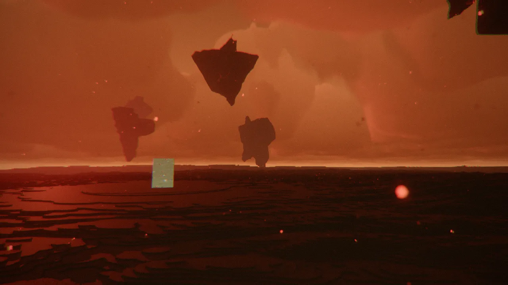
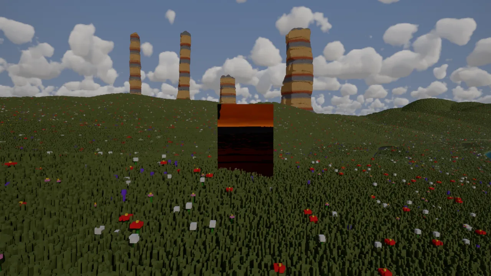

This page makes a second world unlike the first: an **abyss**, reached through a [[Portals|Portal]] from the main world. It is a [[Dimensions|dimension]] of its own, a dead plain of ash and broken rock under a sky of smoke, lit from behind by fire past the horizon, with jagged rocks hanging in the air as far as you can see, embers and ash drifting, and a low drone. The picture never sits quite still: it grains, its edges fringe, and it slowly breathes.



Everything here is ready-made in the engine. The abyss needs five things: a world generator for its ground, a [[Voxel Volumes|Voxel Volume]] that draws it, floating rocks, the **Abyss** look, and a Portal each way.

## The ground

The ground is an endless Voxel Volume with a world generator of its own (see [[Generator Graphs]]). Make it with the volume's **Generator** set to a world of blocks, so its ground takes its colours from a biome.

1. **The blocks.** Two dark ones: an ash nearly black, `color = [0.2, 0.17, 0.15]`, and a rock darker still.
2. **The biome.** Ash on top, the rock under it, a glassy rock where the ground is steeper than about 40°, and **Rock Layers** of rock with a thin seam of something hot through it. Give it the whole range of warmth and wetness, so it is the only biome anywhere. Nothing grows on it.
3. **The generator.** A plain broken in a few ways:
   - a **Noise** (Fractal, Size 120, -6 to 6 m) for the rolling plain;
   - a **Noise** (Billow, Size 7, -1 to 0.9 m) added for rubble and pits;
   - a **Noise** (Ridged, Size 380, 0 to 30 m), multiplied by a broad Fractal mask kept over 0 by a **Math** Max, then through a **Terrace** (Step 5, Sharpness 0.6) for ridges broken into ledges here and there;
   - a **Noise** (Ridged, Size 2600, 0 to 170 m), multiplied by a mask a few kilometres across, for great ranges that stand on the horizon;
   - all through a **Warp**, then a **Blend** with a round **Falloff** to 0 for level ground where the Portal stands.

   Ridged noise sits near its top most of the time, so a ridge or a range wants a mask of its own, or it covers everything.
4. **The world of blocks** names the generator and the biome. Nothing else of it is used.
5. **The volume**, in the dimension: **Endless**, a **Reach** of 64 m and a **Distance** of 1024 m, the world of blocks as its **Generator**, its **Floor** under the lowest ground, and its **Sea** off.

## Floating rocks

An endless volume hangs rocks over its ground with its **Floating Rocks** on. Each is a jagged rock of flat faces and sharp edges, drawn out underneath into ragged tails, with ash on its top and seams that glow. They drift to and fro and turn slowly, each its own way, the small ones faster.

| Setting | What it does |
| --- | --- |
| **Rock Spacing** | How far apart the places a rock may hang are, in metres: 90 |
| **Rocks How Often** | How many of those places have one, 0 to 1 |
| **Rock Size** | How far across a rock is, from the smallest to the largest, in metres. Most are small and a few near the largest |
| **Rock Height** | How high over the ground under it a rock's middle hangs, in metres. A tail never reaches the ground |
| **Rock Drift**, **Rock Turn** | How far the largest drift, in metres, and how fast they turn, in degrees a second |
| **Rock Embers** | How much of a rock is cracked with glowing seams, 0 to 1 |
| **Most Rocks** | The most drawn at once, up to 40: the largest and nearest first |
| **Rock Seed** | Another seed hangs them in other places |

In the scene:

```toml
[obj.voxel_volume.rocks]
spacing = 90.0
how_often = 0.5
size = [3.0, 70.0]
height = [15.0, 120.0]
```

The same settings hang the same rocks over the same ground every time, so every player sees them alike. See [[Voxel Volumes#Floating rocks|Floating rocks]] for how they are made and what they cost.

## The sky, the light and the picture

The **Abyss** look sets them together:

```toml
[post]
look = "abyss"

[post.anti_aliasing]
quality = "balanced"
```

It gives:

- **A sky of smoke.** Dark overhead, a band of orange fire at the horizon, and a low ceiling of thick, billowing cloud with breaks in it.
- **A low sun behind the smoke**, warm and weak, so the rocks stand dark against the glow and shadows are deep. Point the dimension's sun a few degrees over the horizon, away from where players first look.
- **Haze** that hangs high as well as low, so far rocks fade into it, glowing where the light is behind it.
- **Things slightly off.** Colour fringes towards the edges, film grain in the dark, and a view that slowly breathes and wavers. These are post-processing settings of their own: **Grain** and **Warp** (see [[Post-Processing]]).

Give the dimension the same anti-aliasing quality as the rest of the game. The look leaves it at its own, which draws every pixel; the Realm draws at **Balanced**, about three fifths of the screen each way, and so should the abyss.

To change the look from a script, `Post.UsePreset(PostPreset.Abyss)`; to light a scene with it, `LightingSettings.Abyss`.

## Embers, ash and sound

- **Embers.** A Particle System sending out small additive sparks from a Box round where players stand, in World space, rising a little (Gravity -0.03), with Turbulence, as many as 500 a second over a box 60 m wide. A Box much larger spreads them too thin to see.
- **Ash.** Another, grey, lit, falling slowly (Gravity 0.015), 700 a second.
- **The drone.** An Audio Source in **2D**, looping a low chord a little out of tune with distant rumbles in it. A sound plays only in the dimension the game is seen from, so the drone stops the moment the player steps back through.

For a whole world, put the two Particle Systems under the player's camera, so the air round the player is always full.

## The Portals

A Portal in the main world leads into the abyss's **Way Back**, as [[Dimensions#Portals into a dimension|Portals into a dimension]] shows:

```toml
[obj.portal]
size = [3.5, 5.0]
mist = [0.6, 0.2, 0.05]
into = { dimension = "Dimensions/Abyss.dimension", portal = 3 }
```



The abyss is made once a camera comes within the Dimension distance of the Portal. Its endless ground is made round where going through would take that camera, so the far side is already there to see. The view through the opening is drawn at the size the camera's own view is drawn at, and its voxels only where the opening shows.

## What it costs

On an RTX 3070 at 1920 × 1080:

- Standing on the plain with the rocks and the Portal back in view: 15.2 ms a frame.
- The Realm looking through the Portal: 17.0 ms, of which the far side's voxels are 2.7 ms.
- The rocks: drawn at every pixel, 32 of them took 4.9 ms of a frame of 26.4 ms; at Balanced the whole frame is the 15.2 ms above. Each keeps a few MB on the GPU, and is made on a thread in under a second.

## Not done yet

- Floating rocks do not collide; walking off a cliff onto one finds nothing.
- The far side of a Portal is finished with the post-processing of the view it is seen in, not the abyss's own: its grain and warp show only once you are through.
