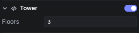
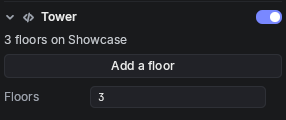

A **behaviour inspector** draws a behaviour's whole section in the Inspector, in place of its list of fields, as a custom `Editor` does in Unity. Derive from `BehaviourInspector<T>`, where `T` is the behaviour. Use one for what is about the behaviour as a whole: a summary of its values, buttons that change several fields at once, or a layout of your own.

To change how one field looks, write a [[Type Drawers|type drawer]] or an [[Attribute Drawers|attribute drawer]] instead; the rest of the section stays as it was.

## An inspector for a Tower

Start with the behaviour, a tower with a number of floors and a height:

```csharp
using Voxear;

namespace MyGame;

public sealed class Tower : Behaviour
{
	public int Floors = 3;
	public float Height = 7.5f;
}
```

Without an inspector, the Tower's section shows its two fields:



The inspector puts a line above them saying how many floors the tower has, and an **Add a floor** button:

```csharp
using Voxear;

namespace MyGame;

public sealed class TowerInspector : BehaviourInspector<Tower>
{
	protected override void Build(UiElement root)
	{
		root.Add(new Label().Bind(() => $"{Target.Floors} floors on {Target.Obj.Name}"));
		root.Add(new Button("Add a floor", AddFloor));
		root.Add(new NextField());
	}

	private void AddFloor()
	{
		Target.Floors++;
		Target.Height = Target.Floors * 2.5f;
	}
}
```



- `Target` is the behaviour. It is a copy made from the scene's values for each draw, on its Obj, so `Target.Obj` is the Obj it is on.
- What a handler changes in `Target`'s fields is saved in the scene, all of it as one step for **Ctrl+Z** to undo. Here **Add a floor** changes two fields, and one undo takes back both.
- `NextField` is where the behaviour's usual fields and buttons go. Leave it out to draw the behaviour entirely yourself.

An inspector also draws the behaviours derived from its type, unless they have an inspector of their own.

## The Tower inspector in markup

In markup, an element named `next` takes the place of the `NextField`, and `Draw` finds the elements by name:

```csharp
using Voxear;

namespace MyGame;

public sealed class TowerInspector : BehaviourInspector<Tower>
{
	public override string Markup => """
		<vui>
			<Label name="summary" />
			<Button name="raise">Add a floor</Button>
			<Panel name="next" />
		</vui>
		""";

	protected override void Draw(Tower tower, UiDocument ui)
	{
		if (ui.Find("raise")!.WasClicked)
		{
			tower.Floors++;
			tower.Height = tower.Floors * 2.5f;
		}
		ui.Find("summary")!.Text = $"{tower.Floors} floors on {tower.Obj.Name}";
	}
}
```

`Draw` gets the same copy as `Target`, and runs on every draw, after the handlers. It gives nothing back: whatever it changes in the copy's fields is saved, as one step to undo.

## Refresh in a behaviour inspector

`Refresh(T behaviour)` runs on the first draw, and whenever the behaviour's fields are not as the elements last showed them: after a handler changed them, on undo, or when a script did. Use it, as in a [[Type Drawers|type drawer]], when a change of value should change several elements at once. Each draw runs in the same order as a drawer's: the handlers, then `Draw`, then `Refresh` when the fields changed, then every `Bind`.

## Reference

| Member | What it does |
| --- | --- |
| `BehaviourInspector<T>` | Draws behaviours of type `T`, and of types derived from it without an inspector of their own |
| `protected T Target { get; }` | A copy of the behaviour made from the scene for each draw, on its Obj. Fields changed in handlers are saved |
| `protected virtual void Build(UiElement root)` | Adds the elements to `root`, once, before the first draw, when `Target` is already set |
| `protected virtual void Refresh(T behaviour)` | Brings the elements up to date. Runs on the first draw, and when the fields changed since the elements last showed them |
| `protected virtual void Draw(T behaviour, UiDocument ui)` | The advanced path. Runs every draw, after the handlers; field changes are saved |
| `public virtual string Markup` | The elements as a `.vui` document. Leave it out to build them in `Build` |
| `public string Label` | The label the Inspector gives what it draws |
