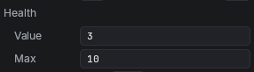

A **type drawer** draws every field of one type in the Inspector, your way. Derive from `ValueDrawer<T>`, where `T` is the type, and every field of that type is drawn by it, on every behaviour, and so is each item of a list of them. Use one for a struct or class of your own that should always look the same.

To draw only some fields of a type, such as the whole numbers you mark, write an [[Attribute Drawers|attribute drawer]] instead. To draw a whole behaviour, write a [[Behaviour Inspectors|behaviour inspector]].

## A drawer for a Health value

Start with the type. It is a struct with two numbers, marked `[Serializable]` so the scene saves it:

```csharp
using System;

namespace MyGame;

[Serializable]
public struct Health
{
	public int Current;
	public int Max;
}
```

Without a drawer, a `Health` field shows its two number boxes:



Now the drawer. It shows the two numbers as one line, with a **Fill** button that fills the health up:

```csharp
using Voxear;

namespace MyGame;

public sealed class HealthDrawer : ValueDrawer<Health>
{
	protected override void Build(UiElement root)
	{
		root.Add(new Label().Bind(() => $"{Value.Current} / {Value.Max}"));
		root.Add(new Button("Fill", () => Value = Value with { Current = Value.Max }) { Tooltip = "Fills the bar" });
	}
}
```


That is the whole drawer:

- `Build` runs once, before the field is first drawn. It adds the drawer's elements to `root`.
- `Value` is the field's value. It already holds it when `Build` runs.
- `Bind` gives the label a function that works out its text. It runs again each time the drawer draws, so the label always shows the value as it is.
- The button's second argument runs when it is clicked. It sets `Value`, and the new value is saved in the scene as one step, so **Ctrl+Z** undoes it.

The drawer has no `NextField`, so it replaces the field's usual boxes. Add `root.Add(new NextField());` and the **Current** and **Max** boxes show there, inside the drawer. See [[Custom Drawers]].

## The Health drawer in markup

A drawer can describe its elements in markup instead, as a `.vui` document written in the code. A raw string, between `"""` marks, keeps it readable. `Draw` then finds each element by its `name`, and does what `Bind` and the handler did:

```csharp
using Voxear;

namespace MyGame;

public sealed class HealthDrawer : ValueDrawer<Health>
{
	public override string Markup => """
		<vui>
			<Label name="text" />
			<Button name="fill" tooltip="Fills the bar">Fill</Button>
		</vui>
		""";

	protected override Health Draw(Health value, UiDocument ui)
	{
		if (ui.Find("fill")!.WasClicked)
		{
			value = value with { Current = value.Max };
		}
		ui.Find("text")!.Text = $"{value.Current} / {value.Max}";
		return value;
	}
}
```

`Draw` is the advanced path. It runs on every draw, after the handlers. It gets the value and the document, writes the value into the elements, and gives the value back, changed by whatever was clicked. A value given back changed is saved, as one step to undo. `WasClicked` and `WasChanged` say what happened since the last draw.

Sheets the markup's `<Style src>` names are read from the project, by their path in it. An element named `next` is where the usual control goes, as a `NextField` is.

## Keeping a slider in step with Refresh

`Bind` suits one element showing one thing. When the value changes several things at once, write `Refresh`. It runs on the first draw, and again whenever the value is not the one the elements last showed: after a handler set it, on undo, or when a script changed it.

This drawer shows the health as a slider, and hides **Fill** when the health is already full:

```csharp
using System;
using Voxear;

namespace MyGame;

public sealed class HealthDrawer : ValueDrawer<Health>
{
	private Slider bar = null!;
	private Button fill = null!;

	protected override void Build(UiElement root)
	{
		bar = root.Add(new Slider(0, 1).OnMoved(Move));
		fill = root.Add(new Button("Fill", () => Value = Value with { Current = Value.Max }));
	}

	protected override void Refresh(Health value)
	{
		bar.Value = value.Max > 0 ? (float)value.Current / value.Max : 0;
		fill.Visible = value.Current < value.Max;
	}

	private void Move(float to)
	{
		Value = Value with { Current = (int)MathF.Round(to * Value.Max) };
	}
}
```

Drag the slider and `Move` sets `Value`; `Refresh` then puts the slider on a whole number and shows or hides **Fill**. Undo, and `Refresh` runs again with the old value. A slider showing a single number can use `Bind` instead: `new Slider(0, 10).Bind(() => Value.Current)`.

## When a drawer draws

The editor draws the field when it first shows, after something in it is clicked or changed, and when the value changes some other way, as on undo. Each time:

1. On the first draw, `Value` is set to the field's value, and then `Build` runs. On later draws, the handlers of whatever was clicked or changed run.
2. `Draw` runs.
3. `Refresh` runs, if the value is not the one the elements last showed. It always runs on the first draw.
4. Every `Bind` is worked out again.

Set `Value` from a handler, `Build`, `Refresh` or `Draw`. Set later, as after an `await`, it is not saved.

## Reference

`ValueDrawer<T>` adds nothing of its own: it is `Drawer<T>`, which `AttributeDrawer` shares, and `Drawer<T>` is a `Drawer`.

| Member | What it does |
| --- | --- |
| `ValueDrawer<T>` | Draws every field of type `T`, and each item of a list of them |
| `protected virtual void Build(UiElement root)` | Adds the elements to `root`, once, before the first draw, when `Value` already holds the field's value |
| `protected T Value { get; set; }` | The field's value. Set by a handler, it is saved in the scene as one step to undo |
| `protected virtual void Refresh(T value)` | Brings the elements up to date. Runs on the first draw, and when the value changed since the elements last showed it |
| `protected virtual T Draw(T value, UiDocument ui)` | The advanced path. Runs every draw, after the handlers; gives back the value, saved when changed |
| `public virtual string Markup` | The elements as a `.vui` document. Leave it out to build them in `Build` |
| `public string Label` | What the Inspector calls the field |

The elements a drawer adds are a game's own ([[UI from Scripts]]); [[Callbacks and Binding]] lists their callbacks and `Bind` methods, and `NextField` is where the usual control goes.
