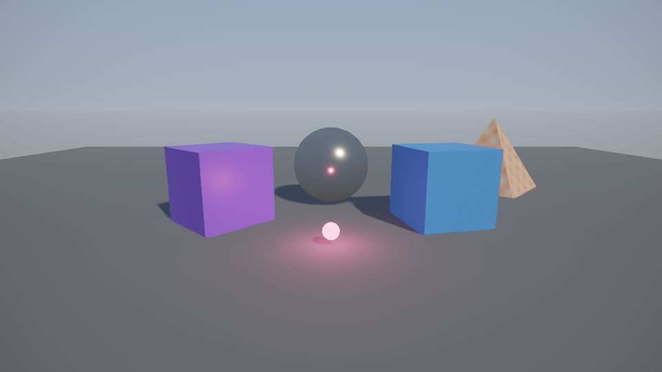

Hello moves between two levels, **Day** and **Night**. Both stand on the **Environment** scene, which stays loaded as one level gives way to the other.

## Who drives it

The `GameManager` keeps the score and walks through the levels its scene lists in `cycle`, each a level and how many seconds to wait first. It loads the next one in the background with `Level.LoadAsync` and carries on once it is in.

Its Obj is ==persistent==, so it survives every level change while the scenes around it come and go. Any script reaches it through `Instance<GameManager>.Current`.

| Level | Scenes | What is in it |
| --- | --- | --- |
| Day | Environment, Day | the sun, the spinners and the chrome ball |
| Night | Environment, Night | lamps, and fireflies around them |

## Fireflies

At night the `FireflySpawner` releases fireflies around the lamps it is given. Fireflies are made at runtime, so they belong to the Night scene and go when it unloads. See [[Scripts]] for the rest.

- [x] Day and Night share the Environment
- [x] The GameManager outlives both
- [ ] Add a third level
